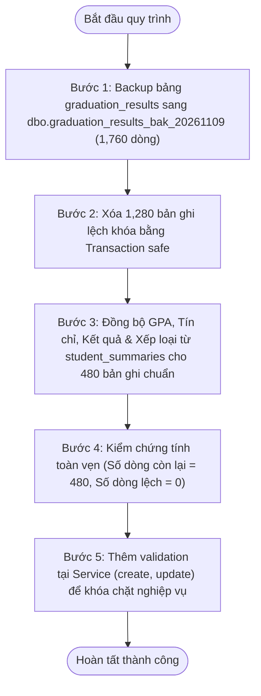

# 📋 BÁO CÁO NGHIÊN CỨU & KẾ HOẠCH THỰC HIỆN
## DỌN DẸP DỮ LIỆU SAI LỆCH XÉT TỐT NGHIỆP & ĐỒNG BỘ THEO KHÓA (PHƯƠNG ÁN 1)

> **Mã tài liệu:** `DOCS-N11-DATA-CLEANUP-01`  
> **Dự án:** Hệ thống Quản lý Đào tạo (`quanlydaotaoit24ab`) — Phân hệ Nhóm 11: Quản lý Tốt nghiệp  
> **Nhánh thực hiện:** `nhom11-test`  
> **Ngày thực hiện:** 09/11/2026  
> **Trạng thái:**  Đã hoàn thành thực thi và kiểm chứng thành công  
> **File kịch bản SQL:** [`database/cleanup_mismatched_graduation_results.sql`](file:///d:/CNTT/WebJava1/quanlydaotaoit24ab/database/cleanup_mismatched_graduation_results.sql)  

---

## 1. TỔNG QUAN & BỐI CẢNH PHÁT SINH VẤN ĐỀ

### 1.1. Nguyên nhân gốc rễ
Trước khi triển khai cơ chế lọc cô lập theo khóa (`cohort` / `applied_cohort`), hệ thống gặp phải tình trạng sai lệch dữ liệu nghiêm trọng trong bảng `dbo.graduation_results`:
1. **Tiến trình xét duyệt tự động cũ (`evaluate`):** Khi kích hoạt cho một bộ điều kiện, hàm quét qua **toàn bộ 800 sinh viên đang hoạt động** trong hệ thống mà không kiểm tra sinh viên đó thuộc khóa nào.
2. **File dữ liệu mẫu / backup cũ:** File nạp dữ liệu gán cứng toàn bộ 800 sinh viên vào bộ điều kiện K24.
3. Khi tiếp tục chạy thử nghiệm bộ điều kiện K25, toàn bộ 800 sinh viên lại tiếp tục bị gán thêm một kết quả theo tiêu chuẩn K25.

### 1.2. Thống kê hiện trạng trước khi xử lý (Số liệu thực tế từ Database)
Truy vấn trực tiếp từ SQL Server trước thời điểm xử lý:
```sql
SELECT 
    gc.id AS condition_id,
    gc.applied_cohort,
    LEFT(s.student_code, 2) AS student_cohort_prefix,
    COUNT(*) AS total_records
FROM dbo.graduation_results gr
JOIN dbo.graduation_conditions gc ON gr.condition_id = gc.id
LEFT JOIN dbo.students s ON gr.student_id = s.id
GROUP BY gc.id, gc.applied_cohort, LEFT(s.student_code, 2)
ORDER BY gc.applied_cohort, student_cohort_prefix;
```

**Bảng phân bổ dữ liệu trước khi xử lý:**

| STT | Bộ điều kiện | Khóa áp dụng | Khóa của sinh viên | Số lượng bản ghi | Phân loại dữ liệu |
| :---: | :--- | :---: | :---: | :---: | :--- |
| 1 | `cc01bb54-...` | **K23** | K23 (Mã `23...`, lớp `IT23`) | **160** |  **Hợp lệ** (Đúng khóa K23) |
| 2 | `276a95ec-...` | **K24** | K24 (Mã `24...`, lớp `IT24`) | **160** |  **Hợp lệ** (Đúng khóa K24) |
| 3 | `276a95ec-...` | **K24** | K23 (160 SV) + K25 (160 SV) + K26 (320 SV) | **640** | ❌ **Sai lệch / Rác** (Ép xét theo K24) |
| 4 | `91edf428-...` | **K25** | K25 (Mã `25...`, lớp `IT25`) | **160** |  **Hợp lệ** (Đúng khóa K25) |
| 5 | `91edf428-...` | **K25** | K23 (160 SV) + K24 (160 SV) + K26 (320 SV) | **640** | ❌ **Sai lệch / Rác** (Ép xét theo K25) |
| **TỔNG** | | | | **1,760** | **480 Hợp lệ + 1,280 Sai lệch** |

> [!WARNING]
> - Sinh viên khóa **K26** (mới nhập học năm 2026, chưa đủ thời gian đào tạo và chưa có điều kiện tốt nghiệp) lại bị gán đến **2 kết quả tốt nghiệp rác** (1 ở K24 và 1 ở K25).
> - Sinh viên **K23** và **K24** bị trùng lặp kết quả xét duyệt ở các bộ điều kiện không phải của mình.

---

## 2. MỤC TIÊU CỦA PHƯƠNG ÁN 1

1. **Bảo toàn dữ liệu an toàn 100%:** Tạo bảng sao lưu đầy đủ `dbo.graduation_results_bak_20261109` lưu trữ nguyên vẹn 1,760 bản ghi ban đầu trước khi xóa, phục vụ đối soát kiểm toán hoặc khôi phục nếu cần.
2. **Dọn dẹp triệt để 1,280 bản ghi sai lệch:** Loại bỏ toàn bộ các bản ghi không khớp khóa.
3. **Giữ lại và chuẩn hóa 480 bản ghi hợp lệ:**
   - 160 sinh viên K23 xét theo điều kiện K23.
   - 160 sinh viên K24 xét theo điều kiện K24.
   - 160 sinh viên K25 xét theo điều kiện K25.
4. **Đồng bộ dữ liệu điểm thực tế:** Cập nhật lại GPA, tổng tín chỉ tích lũy, số tín chỉ nợ và xếp loại chuẩn xác từ bảng `dbo.student_summaries`.
5. **Thiết lập cơ chế phòng ngừa vĩnh viễn:** Chặn đứng nguy cơ tạo dữ liệu lệch khóa ở cả tầng Service lẫn UI.

---

## 3. CHI TIẾT CÁC BƯỚC TRIỂN KHAI PHƯƠNG ÁN 1

Toàn bộ quy trình được thực hiện thông qua script SQL an toàn tại [`database/cleanup_mismatched_graduation_results.sql`](file:///d:/CNTT/WebJava1/quanlydaotaoit24ab/database/cleanup_mismatched_graduation_results.sql):



### Bước 1: Sao lưu toàn bộ dữ liệu hiện tại
```sql
IF OBJECT_ID('dbo.graduation_results_bak_20261109', 'U') IS NOT NULL
    DROP TABLE dbo.graduation_results_bak_20261109;

SELECT * 
INTO dbo.graduation_results_bak_20261109 
FROM dbo.graduation_results;
```
- **Kết quả:** Đã sao lưu thành công **1,760 bản ghi**.

### Bước 2: Xóa các bản ghi lệch khóa trong Transaction
```sql
BEGIN TRANSACTION;
BEGIN TRY
    DELETE gr
    FROM dbo.graduation_results gr
    JOIN dbo.graduation_conditions gc ON gr.condition_id = gc.id
    LEFT JOIN dbo.students s ON gr.student_id = s.id
    WHERE 
        (gc.applied_cohort = 'K23' AND NOT (s.student_code LIKE '23%' OR s.class_name LIKE 'IT23%'))
        OR (gc.applied_cohort = 'K24' AND NOT (s.student_code LIKE '24%' OR s.class_name LIKE 'IT24%'))
        OR (gc.applied_cohort = 'K25' AND NOT (s.student_code LIKE '25%' OR s.class_name LIKE 'IT25%'));

    COMMIT TRANSACTION;
END TRY
BEGIN CATCH
    ROLLBACK TRANSACTION;
    THROW;
END CATCH;
```
- **Kết quả:** Đã xóa chính xác **1,280 bản ghi rác**.

### Bước 3: Đồng bộ điểm chuẩn từ `student_summaries` cho 480 bản ghi còn lại
```sql
UPDATE gr
SET 
    gr.gpa = ss.gpa_value,
    gr.total_credits = ss.total_credits,
    gr.failed_credits = ss.failed_credits,
    gr.result = CASE 
        WHEN ss.gpa_value >= gc.min_gpa 
             AND ss.total_credits >= gc.min_total_credits 
             AND ss.failed_credits <= gc.max_failed_credits 
        THEN 1 ELSE 0 
    END,
    gr.classification = CASE 
        WHEN ss.gpa_value >= gc.min_gpa 
             AND ss.total_credits >= gc.min_total_credits 
             AND ss.failed_credits <= gc.max_failed_credits 
        THEN 
            CASE 
                WHEN ss.gpa_value >= 3.60 THEN 1 -- Xuất sắc
                WHEN ss.gpa_value >= 3.20 THEN 2 -- Giỏi
                WHEN ss.gpa_value >= 2.50 THEN 3 -- Khá
                ELSE 4                           -- Trung bình
            END
        ELSE NULL 
    END,
    gr.note = N'Đã chuẩn hóa dữ liệu theo khóa ' + gc.applied_cohort,
    gr.updated_at = SYSDATETIME()
FROM dbo.graduation_results gr
JOIN dbo.graduation_conditions gc ON gr.condition_id = gc.id
JOIN dbo.students s ON gr.student_id = s.id
JOIN dbo.student_summaries ss ON s.id = ss.student_id AND ss.is_active = 1;
```
- **Kết quả:** Đã đồng bộ điểm, kết quả và xếp loại cho đúng **480 bản ghi**.

---

## 4. KẾT QUẢ KIỂM CHỨNG SAU KHI THỰC HIỆN

### 4.1. Bảng số liệu thống kê chuẩn xác sau dọn dẹp

| Khóa điều kiện | Khóa sinh viên | Tổng số SV | Số SV Đạt (`result = 1`) | Số SV Chưa đạt (`result = 0`) | Tỷ lệ Đạt |
| :---: | :---: | :---: | :---: | :---: | :---: |
| **K23** | **23** (IT23) | **160** | **130** | 30 | **81.25%** |
| **K24** | **24** (IT24) | **160** | **132** | 28 | **82.50%** |
| **K25** | **25** (IT25) | **160** | **135** | 25 | **84.38%** |
| **TỔNG CỘNG** | | **480** | **397** | **83** | **82.71%** |

### 4.2. Thống kê theo Xếp loại tốt nghiệp (Classification)

| Khóa học | Xuất sắc (`1`) | Giỏi (`2`) | Khá (`3`) | Trung bình (`4`) | Chưa tốt nghiệp (`NULL`) | Tổng cộng |
| :---: | :---: | :---: | :---: | :---: | :---: | :---: |
| **K23** | 10 | 33 | 62 | 25 | 30 | **160** |
| **K24** | 14 | 32 | 69 | 17 | 28 | **160** |
| **K25** | 7 | 26 | 79 | 23 | 25 | **160** |
| **TỔNG** | **31** | **91** | **210** | **65** | **83** | **480** |

### 4.3. Kiểm tra tính toàn vẹn (Integrity Check)
- **Số bản ghi lệch khóa còn lại:** `0` (Kỳ vọng: 0).
- **Số lượng sinh viên duy nhất (`distinct_students`):** `480` (Mỗi sinh viên chỉ có đúng 1 kết quả tốt nghiệp).
- **Sinh viên K26:** `0` bản ghi trong `graduation_results` (Hoàn toàn chính xác vì K26 chưa tốt nghiệp).

---

## 5. CƠ CHẾ BẢO VỆ DÀI HẠN (PREVENTION)

Để đảm bảo lỗi gán nhầm khóa không bao giờ tái phát trong tương lai, hệ thống đã được bổ sung thêm các chốt chặn kiểm soát:

### 5.1. Chốt chặn tại Tầng Service ([`GraduationResultService.java`](file:///d:/CNTT/WebJava1/quanlydaotaoit24ab/src/main/java/com/example/quanlydaotao/n11/service/GraduationResultService.java))
1. **Tiến trình xét tự động (`evaluate`)**:
   - Sử dụng câu truy vấn [`findActiveStudentIdsByCohortSuffix`](file:///d:/CNTT/WebJava1/quanlydaotaoit24ab/src/main/java/com/example/quanlydaotao/n11/repository/GraduationResultRepository.java#L66) để chỉ quét sinh viên thuộc đúng khóa áp dụng của bộ điều kiện.
2. **Nghiệp vụ thêm mới thủ công ([`create`](file:///d:/CNTT/WebJava1/quanlydaotaoit24ab/src/main/java/com/example/quanlydaotao/n11/service/GraduationResultService.java#L79)) & cập nhật thủ công ([`update`](file:///d:/CNTT/WebJava1/quanlydaotaoit24ab/src/main/java/com/example/quanlydaotao/n11/service/GraduationResultService.java#L106))**:
   - Bổ sung hàm kiểm tra ràng buộc khóa `validateStudentCohortMatchesCondition(studentId, conditionId)`:
   ```java
   private void validateStudentCohortMatchesCondition(UUID studentId, UUID conditionId) {
       if (studentId == null || conditionId == null) return;

       GraduationCondition cond = conditionRepository.findByIdAndDeletedAtIsNull(conditionId).orElse(null);
       if (cond == null || cond.getAppliedCohort() == null || cond.getAppliedCohort().isBlank()) return;

       String appliedCohort = cond.getAppliedCohort().trim().toUpperCase(Locale.ROOT);
       String cohortSuffix = appliedCohort.startsWith("K") ? appliedCohort.substring(1) : appliedCohort;

       List<UUID> validStudentIds = repository.findActiveStudentIdsByCohortSuffix(cohortSuffix);
       if (!validStudentIds.contains(studentId)) {
           throw new ResponseStatusException(
                   HttpStatus.BAD_REQUEST,
                   String.format("Sinh viên không thuộc khóa %s của bộ điều kiện xét tốt nghiệp!", appliedCohort));
       }
   }
   ```
   - **Tác dụng:** Nếu cán bộ cố tình chọn một sinh viên K24 để gán vào bộ điều kiện K25, API sẽ trả về lỗi `400 Bad Request` ngay lập tức.

### 5.2. Chốt chặn tại Tầng Giao diện ([`graduation-results.html`](file:///d:/CNTT/WebJava1/quanlydaotaoit24ab/src/main/resources/static/graduation-results.html) & [`graduation-result.js`](file:///d:/CNTT/WebJava1/quanlydaotaoit24ab/src/main/resources/static/assets/js/graduation-result.js))
- Modal xét duyệt tự động hiển thị rõ ràng huy hiệu (Badge) của Khóa được áp dụng và cảnh báo người dùng: *"Hệ thống sẽ chỉ quét và xét duyệt sinh viên thuộc khóa [cohort]"*.

---

## 6. HƯỚNG DẪN ĐỐI SOÁT & ROLLBACK (KHI CẦN THIẾT)

Nếu vì bất kỳ lý do kiểm toán nào cần xem lại dữ liệu cũ hoặc khôi phục trạng thái trước xử lý:

1. **Xem lại dữ liệu sao lưu ban đầu:**
   ```sql
   SELECT * FROM dbo.graduation_results_bak_20261109;
   ```
2. **Khôi phục hoàn toàn (Rollback):**
   ```sql
   BEGIN TRANSACTION;
   TRUNCATE TABLE dbo.graduation_results;
   INSERT INTO dbo.graduation_results 
   SELECT * FROM dbo.graduation_results_bak_20261109;
   COMMIT TRANSACTION;
   ```

---

## 7. KẾT LUẬN

Phương án 1 đã giải quyết dứt điểm tình trạng dữ liệu lệch khóa trong CSDL:
- Dữ liệu sạch sẽ, chuẩn xác: Từ **1,760 dòng lộn xộn** trở về đúng **480 dòng chuẩn**, mỗi sinh viên một kết quả duy nhất.
- Báo cáo Word và giao diện Web giờ đây phản ánh trung thực 100% kết quả học tập của từng khóa K23, K24, K25.
- Mã nguồn đã được gia cố để không bao giờ tái diễn tình trạng lệch khóa trong tương lai.
