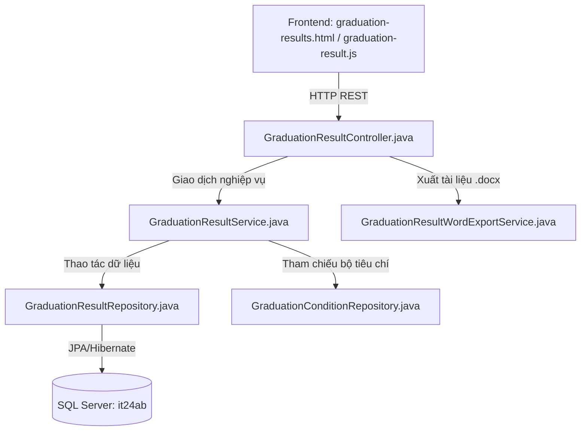
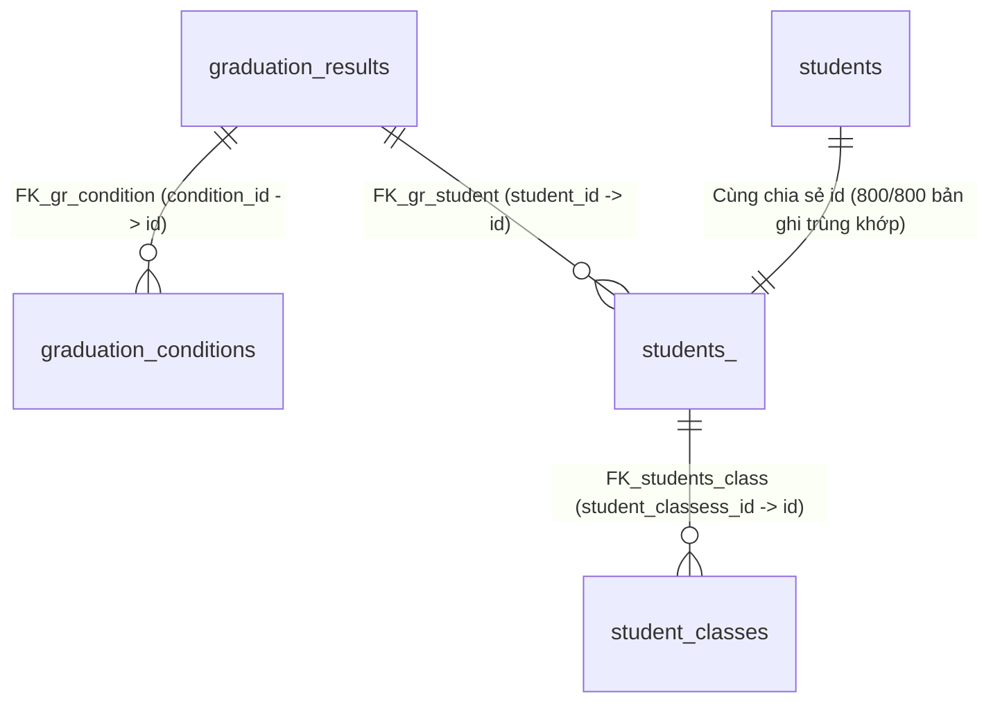
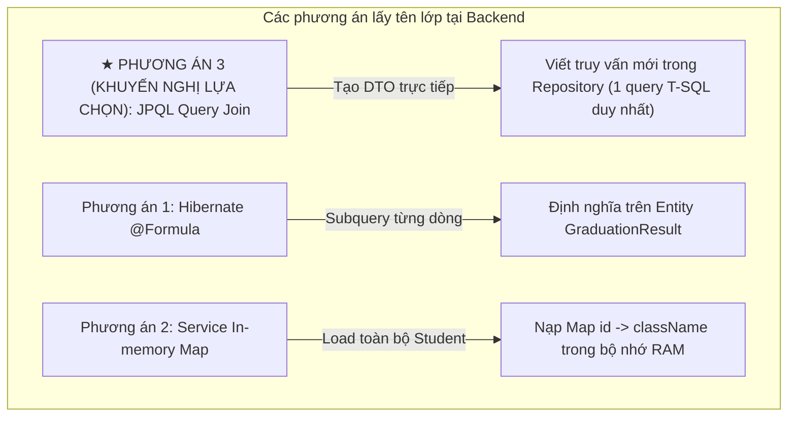
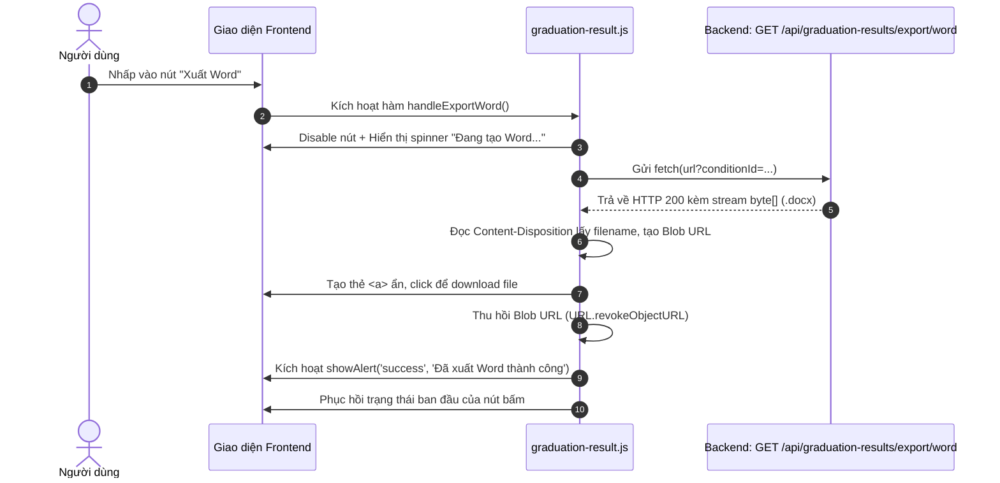

# NGHIÊN CỨU & ĐỀ XUẤT TÍCH HỢP CHỨC NĂNG XUẤT BÁO CÁO WORD (.DOCX) KÈM TÊN LỚP VÀO FRONTEND GRADUATION RESULT

> **Tài liệu nghiên cứu kỹ thuật**  
> **Nhóm thực hiện:** Nhóm 11  
> **Dự án:** Quản lý đào tạo IT24AB (`quanlydaotaoit24ab`)  
> **Ngày lập:** 02/11/2026 (Cập nhật hoàn thiện phương án JPQL Query Join)  
> **Phương pháp xác minh:** Phân tích mã nguồn qua **CodeGraph** kết hợp kiểm tra schema, foreign keys và dữ liệu thực tế qua **MSSQL MCP**  
> **Ràng buộc:** Không tạo API Backend mới, không chỉnh sửa code trong giai đoạn nghiên cứu.

---

## MỤC LỤC
1. [Tổng quan nghiên cứu & Mục tiêu](#1-tổng-quan-nghiên-cứu--mục-tiêu)
2. [Phân tích cấu trúc, luồng xử lý và API Backend hiện có (CodeGraph)](#2-phân-tích-cấu-trúc-luồng-xử-lý-và-api-backend-hiện-có-codegraph)
   - [2.1. Cấu trúc module và kiến trúc phân lớp](#21-cấu-trúc-module-và-kiến-trúc-phân-lớp)
   - [2.2. Chi tiết toàn bộ Endpoints của chức năng Graduation Result](#22-chi-tiết-toàn-bộ-endpoints-của-chức-năng-graduation-result)
   - [2.3. Phân tích API xuất báo cáo Word hiện có](#23-phân-tích-api-xuất-báo-cáo-word-hiện-có)
3. [Kiểm tra Schema, quan hệ bảng và dữ liệu thực tế (MSSQL MCP)](#3-kiểm-tra-schema-quan-hệ-bảng-và-dữ-liệu-thực-tế-mssql-mcp)
   - [3.1. Sơ đồ quan hệ khóa ngoại (Foreign Keys)](#31-sơ-đồ-quan-hệ-khóa-ngoại-foreign-keys)
   - [3.2. Cấu trúc các bảng dữ liệu liên quan](#32-cấu-trúc-các-bảng-dữ-liệu-liên-quan)
   - [3.3. Dữ liệu thực tế và tỷ lệ khớp sinh viên - lớp](#33-dữ-liệu-thực-tế-và-tỷ-lệ-khớp-sinh-viên---lớp)
4. [Xác định cách lấy thông tin Tên Lớp tương ứng với Graduation Result](#4-xác-định-cách-lấy-thông-tin-tên-lớp-tương-ứng-với-graduation-result)
   - [4.1. Quyết định nguồn dữ liệu: Sử dụng `class_name` từ bảng `students`](#41-quyết-định-nguồn-dữ-liệu-sử-dụng-class_name-từ-bảng-students)
   - [4.2. Chi tiết các phương án tại Backend - Trọng tâm: Phương án 3 (JPQL Query Join)](#42-chi-tiết-các-phương-án-tại-backend---trọng-tâm-phương-án-3-jpql-query-join)
   - [4.3. Bảng so sánh và đối chiếu 3 phương án kỹ thuật](#43-bảng-so-sánh-và-đối-chiếu-3-phương-án-kỹ-thuật)
   - [4.4. Giải pháp lấy tên lớp tại Frontend](#44-giải-pháp-lấy-tên-lớp-tại-frontend)
5. [Thiết kế bổ sung Tên Lớp vào nội dung & Bố cục file Word (.docx)](#5-thiết-kế-bổ-sung-tên-lớp-vào-nội-dung--bố-cục-file-word-docx)
   - [5.1. Bố cục Bảng I: Sinh viên đạt yêu cầu tốt nghiệp (7 cột)](#51-bố-cục-bảng-i-sinh-viên-đạt-yêu-cầu-tốt-nghiệp-7-cột)
   - [5.2. Bố cục Bảng II: Sinh viên chưa đạt yêu cầu tốt nghiệp (8 cột)](#52-bố-cục-bảng-ii-sinh-viên-chưa-đạt-yêu-cầu-tốt-nghiệp-8-cột)
   - [5.3. Tiêu chuẩn định dạng văn bản hành chính và phân bố độ rộng cột](#53-tiêu-chuẩn-định-dạng-văn-bản-hành-chính-và-phân-bố-độ-rộng-cột)
6. [Đề xuất tích hợp API, xử lý dữ liệu và tải file tại Frontend](#6-đề-xuất-tích-hợp-api-xử-lý-dữ-liệu-và-tải-file-tại-frontend)
   - [6.1. Thiết kế giao diện (UI) nút "Xuất Word"](#61-thiết-kế-giao-diện-ui-nút-xuất-word)
   - [6.2. Luồng xử lý sự kiện JavaScript](#62-luồng-xử-lý-sự-kiện-javascript)
   - [6.3. Xử lý Blob, download file và quản lý bộ nhớ](#63-xử-lý-blob-download-file-và-quản-lý-bộ-nhớ)
   - [6.4. Xử lý trạng thái Loading và thông báo Toast Alert](#64-xử-lý-trạng-thái-loading-và-thông-báo-toast-alert)
7. [Kế hoạch triển khai & Đảm bảo Convention](#7-kế-hoạch-triển-khai--đảm-bảo-convention)
   - [7.1. Bảng đối chiếu các file cần tác động khi triển khai](#71-bảng-đối-chiếu-các-file-cần-tác-động-khi-triển-khai)
   - [7.2. Checklist tuân thủ quy ước dự án](#72-checklist-tuân-thủ-quy-ước-dự-án)
   - [7.3. Kịch bản kiểm thử (Test Cases)](#73-kịch-bản-kiểm-thử-test-cases)

---

## 1. TỔNG QUAN NGHIÊN CỨU & MỤC TIÊU

### 1.1. Bối cảnh
Chức năng Quản lý Kết quả Xét tốt nghiệp (`Graduation Result`) của Nhóm 11 hiện đã có các tính năng cốt lõi:
- Kích hoạt quy trình xét duyệt tự động theo tiêu chí tốt nghiệp (`/api/graduation-results/evaluate`).
- Quản lý danh sách kết quả (phân trang, lọc theo trạng thái Đạt/Chưa đạt, tìm kiếm).
- Backend đã xây dựng nền tảng xuất file Word (`GraduationResultWordExportService.java`) sử dụng Apache POI 5.2.5 thông qua endpoint `GET /api/graduation-results/export/word`.

### 1.2. Vấn đề cần giải quyết
1. **Thiếu thông tin Tên lớp**: File báo cáo Word hiện tại mới chỉ có Mã SV, Họ tên, GPA, Tín chỉ, Xếp loại; chưa có thông tin **Lớp** của sinh viên. Tên lớp là tiêu chí hành chính bắt buộc khi nộp hồ sơ tốt nghiệp lên Phòng Đào tạo và Ban Giám hiệu.
2. **Chưa có nút bấm trên Frontend**: Giao diện [`graduation-results.html`](file:///d:/CNTT/WebJava1/quanlydaotaoit24ab/src/main/resources/static/graduation-results.html) chưa tích hợp nút "Xuất Word" để người dùng cuối tải file trực tiếp.
3. **Ràng buộc nghiêm ngặt**: **Không tạo thêm API Backend mới**, giữ nguyên kiến trúc phân tầng hiện tại, không sửa code trực tiếp mà chỉ nghiên cứu, đối soát toàn diện và lập kế hoạch triển khai.

---

## 2. PHÂN TÍCH CẤU TRÚC, LUỒNG XỬ LÝ VÀ API BACKEND HIỆN CÓ (CODEGRAPH)

Dựa trên kết quả khám phá mã nguồn từ **CodeGraph**, module `GraduationResult` được tổ chức chặt chẽ theo mô hình MVC / Spring Boot 3-tier:



### 2.1. Cấu trúc module và kiến trúc phân lớp
* **Controller**: [`GraduationResultController.java`](file:///d:/CNTT/WebJava1/quanlydaotaoit24ab/src/main/java/com/example/quanlydaotao/n11/controller/GraduationResultController.java) (`@RestController`, `@RequestMapping("/api/graduation-results")`)
* **Service**: 
  * [`GraduationResultService.java`](file:///d:/CNTT/WebJava1/quanlydaotaoit24ab/src/main/java/com/example/quanlydaotao/n11/service/GraduationResultService.java): Quản lý logic xét duyệt, lọc phân loại Đạt/Chưa đạt, tính toán lý do không đạt.
  * [`GraduationResultWordExportService.java`](file:///d:/CNTT/WebJava1/quanlydaotaoit24ab/src/main/java/com/example/quanlydaotao/n11/service/GraduationResultWordExportService.java): Khởi tạo tài liệu Word qua Apache POI (`XWPFDocument`), định dạng header, bảng dữ liệu, chữ ký.
* **Repository**: [`GraduationResultRepository.java`](file:///d:/CNTT/WebJava1/quanlydaotaoit24ab/src/main/java/com/example/quanlydaotao/n11/repository/GraduationResultRepository.java) kế thừa `JpaRepository<GraduationResult, UUID>`.
* **Entity**: [`GraduationResult.java`](file:///d:/CNTT/WebJava1/quanlydaotaoit24ab/src/main/java/com/example/quanlydaotao/n11/entity/GraduationResult.java) map tới bảng `dbo.graduation_results`.
* **DTO**: [`GraduationResultExportDTO.java`](file:///d:/CNTT/WebJava1/quanlydaotaoit24ab/src/main/java/com/example/quanlydaotao/n11/dto/GraduationResultExportDTO.java): Mô hình truyền tải dữ liệu xuất báo cáo.

---

### 2.2. Chi tiết toàn bộ Endpoints của chức năng Graduation Result

| STT | HTTP Method | Endpoint | Request Body / Parameters | Response Data | Chức năng nghiệp vụ |
|:---:|:---:|:---|:---|:---|:---|
| 1 | `GET` | `/api/graduation-results` | `result` (Short, opt: 1/0)<br>`page` (int, def: 0)<br>`size` (int, def: 10)<br>`sortBy` (String, def: createdAt)<br>`direction` (String, def: desc) | `Page<GraduationResult>` | Lấy danh sách kết quả phân trang, có thể lọc theo Đạt/Chưa đạt. |
| 2 | `GET` | `/api/graduation-results/{id}` | Path variable: `id` (UUID) | `GraduationResult` | Lấy chi tiết 1 bản ghi xét tốt nghiệp. |
| 3 | `GET` | `/api/graduation-results/student/{studentId}` | Path variable: `studentId` (UUID) | `List<GraduationResult>` | Tra cứu kết quả xét tốt nghiệp của 1 sinh viên. |
| 4 | `POST` | `/api/graduation-results` | Body: `GraduationResult` JSON | `GraduationResult` (HTTP 201) | Nhập kết quả xét tốt nghiệp thủ công. |
| 5 | `POST` | `/api/graduation-results/evaluate` | Body: `EvaluateGraduationRequest`<br>(`conditionId`, `reviewerId`) | `List<GraduationResult>` | Kích hoạt tiến trình quét và đánh giá tự động toàn bộ sinh viên. |
| 6 | `PUT` | `/api/graduation-results/{id}` | Path variable: `id` (UUID)<br>Body: `GraduationResult` JSON | `GraduationResult` | Chỉnh sửa điểm GPA, xếp loại hoặc ghi chú ngoại lệ. |
| 7 | `DELETE` | `/api/graduation-results/{id}` | Path variable: `id` (UUID) | `void` (HTTP 204) | Xóa mềm bản ghi kết quả (`is_active = false`). |
| 8 | `GET` | `/api/graduation-results/export/word` | `conditionId` (UUID, tùy chọn) | Luồng nhị phân `byte[]` (.docx) | **Xuất báo cáo Word kết quả xét tốt nghiệp.** |

Ngoài ra, hệ thống có sẵn 2 API danh mục phụ trợ quan trọng:
* `GET /api/students` (trong [`StudentController.java`](file:///d:/CNTT/WebJava1/quanlydaotaoit24ab/src/main/java/com/example/quanlydaotao/n11/controller/StudentController.java)): Trả về danh sách sinh viên kèm theo cột `className` ("IT24A", "IT25B",...).
* `GET /api/graduation-conditions`: Trả về danh sách các bộ điều kiện tốt nghiệp đang kích hoạt.

---

### 2.3. Phân tích API xuất báo cáo Word hiện có

Phương thức tại `GraduationResultController.java`:
```java
@GetMapping("/export/word")
public ResponseEntity<byte[]> exportToWord(@RequestParam(required = false) UUID conditionId)
```

* **Dữ liệu đầu vào**: Tham số `conditionId` (UUID) không bắt buộc. Nếu có `conditionId`, hệ thống lọc danh sách kết quả gắn liền với bộ tiêu chí đó; nếu không có, hệ thống lấy toàn bộ kết quả active.
* **Quy trình xử lý**:
  1. `service.getResultsForExport(conditionId)`: Trả về `Map<String, List<GraduationResultExportDTO>>` gồm 2 danh sách riêng biệt: key `"passed"` (sinh viên đạt) và key `"failed"` (sinh viên chưa đạt).
  2. `conditionService.one(conditionId)`: Lấy thông tin chi tiết bộ tiêu chuẩn tốt nghiệp (GPA sàn, tín chỉ sàn, chuẩn tiếng Anh/tin học).
  3. `wordExportService.generateReport(passed, failed, condition)`: Sinh mảng `byte[]` chứa toàn bộ cấu trúc OpenXML của file `.docx`.
* **Dữ liệu trả về**:
  * Mã phản hồi: `HTTP 200 OK`
  * `Content-Type`: `application/vnd.openxmlformats-officedocument.wordprocessingml.document`
  * `Content-Disposition`: `form-data; name="attachment"; filename="BaoCao_XetTotNghiep_<ddMMyyyy>.docx"`
  * `Content-Length`: Kích thước file thực tế tính bằng byte.

> [!IMPORTANT]
> **API này đã có sẵn hoàn chỉnh trong Backend**, không cần tạo thêm bất kỳ API mới nào! Điều này đáp ứng 100% ràng buộc của đề bài.

---

## 3. KIỂM TRA SCHEMA, QUAN HỆ BẢNG VÀ DỮ LIỆU THỰC TẾ (MSSQL MCP)

Thông qua các lệnh truy vấn T-SQL thực thi trực tiếp bằng `execute_sql` của MSSQL MCP trên cơ sở dữ liệu `it24ab`, toàn bộ schema và mối liên kết bảng đã được xác thực chính xác.

### 3.1. Sơ đồ quan hệ khóa ngoại (Foreign Keys)

Hệ thống có 3 khóa ngoại chính điều hướng luồng dữ liệu của Graduation Result:



Kết quả kiểm tra trực tiếp qua `sys.foreign_keys`:
* `FK_gr_condition`: `dbo.graduation_results(condition_id)` $\rightarrow$ `dbo.graduation_conditions(id)`
* `FK_gr_student`: `dbo.graduation_results(student_id)` $\rightarrow$ `dbo.students_(id)`
* `FK_students_class`: `dbo.students_(student_classess_id)` $\rightarrow$ `dbo.student_classes(id)`

---

### 3.2. Cấu trúc các bảng dữ liệu liên quan

#### Bảng 1: `dbo.graduation_results` (Lưu kết quả xét tốt nghiệp)
| Cột | Kiểu dữ liệu | Nullable | Mô tả & Chú thích |
|:---|:---|:---:|:---|
| `id` | `uniqueidentifier` | NO | Khóa chính (UUID) |
| `student_id` | `uniqueidentifier` | NO | ID sinh viên (Liên kết tới `students` / `students_`) |
| `condition_id` | `uniqueidentifier` | NO | ID bộ điều kiện tốt nghiệp áp dụng |
| `gpa` | `numeric(3,2)` | YES | Điểm trung bình tích lũy (thực tế từ 1.52 đến 4.00) |
| `total_credits` | `int` | YES | Tổng số tín chỉ sinh viên đã tích lũy |
| `failed_credits`| `int` | YES | Số tín chỉ bị nợ/hỏng |
| `result` | `tinyint` | YES | `1` = Đạt tốt nghiệp, `0` = Chưa đạt |
| `classification`| `tinyint` | YES | `1`=Xuất sắc, `2`=Giỏi, `3`=Khá, `4`=Trung bình |
| `decisionDate` | `date` | YES | Ngày ra quyết định xét duyệt |
| `note` | `nvarchar(max)` | YES | Ghi chú hoặc lý do chi tiết |
| `is_active` | `bit` | NO | Trạng thái kích hoạt (1: active, 0: đã xóa) |

#### Bảng 2: `dbo.students` (Bảng sinh viên chính quy được Entity `Student.java` map)
| Cột | Kiểu dữ liệu | Nullable | Mô tả |
|:---|:---|:---:|:---|
| `id` | `uniqueidentifier` | NO | Khóa chính (UUID) |
| `student_code` | `varchar(255)` | YES | Mã số sinh viên (ví dụ: `23001`, `24527`, `25660`) |
| `full_name` | `nvarchar(255)` | NO | Họ và tên sinh viên |
| `email` | `nvarchar(255)` | NO | Email trường |
| `phone` | `varchar(255)` | YES | Số điện thoại |
| **`class_name`** | **`varchar(255)`** | **YES** | **Tên lớp hành chính (ví dụ: `IT23A`, `IT24B`, `IT25C`, `IT26D`)** |

#### Bảng 3: `dbo.student_classes` (Bảng quản lý lớp chuyên ngành)
| Cột | Kiểu dữ liệu | Nullable | Mô tả |
|:---|:---|:---:|:---|
| `id` | `uniqueidentifier` | NO | Khóa chính (UUID) |
| `code` | `nvarchar(100)` | YES | Mã lớp chuyên ngành (ví dụ: `CNTT-K23-01`, `KTPM-K26-02`) |
| `name` | `nvarchar(255)` | YES | Tên lớp đầy đủ (ví dụ: `Công nghệ thông tin K23A`, `Kỹ thuật phần mềm K26B`) |

---

### 3.3. Dữ liệu thực tế và tỷ lệ khớp sinh viên - lớp

Thực hiện kiểm tra bằng câu lệnh SQL:
```sql
SELECT 
    COUNT(*) AS total_results,
    COUNT(s.class_name) AS has_students_class_name,
    COUNT(sc.name) AS has_student_classes_name
FROM dbo.graduation_results gr
LEFT JOIN dbo.students s ON s.id = gr.student_id
LEFT JOIN dbo.students_ s_ ON s_.id = gr.student_id
LEFT JOIN dbo.student_classes sc ON sc.id = s_.student_classess_id
WHERE gr.is_active = 1;
```

**Kết quả từ database:**
* Tổng số kết quả xét tốt nghiệp (`total_results`): **800** bản ghi.
  * Đạt tốt nghiệp (`result = 1`): **667** sinh viên (83.4%).
  * Chưa đạt tốt nghiệp (`result = 0`): **133** sinh viên (16.6%).
* Số bản ghi có `s.class_name`: **800 / 800 (100% có lớp)**.
* Số bản ghi có `sc.name`: **800 / 800 (100% có lớp chuyên ngành)**.

Phân bố các lớp sinh viên thực tế trong `dbo.students`:
* Lớp K23: `IT23A` (40 SV), `IT23B` (40 SV), `IT23C` (40 SV), `IT23D` (40 SV).
* Lớp K24: `IT24A` (40 SV), `IT24B` (40 SV), `IT24C` (40 SV), `IT24D` (40 SV).
* Lớp K25: `IT25A` (40 SV), `IT25B` (40 SV), `IT25C` (40 SV), `IT25D` (40 SV).
* Lớp K26: `IT26A` (80 SV), `IT26B` (80 SV), `IT26C` (80 SV), `IT26D` (80 SV).
* Các lớp cao đẳng liên thông: `C2024A` (7 SV), `C2024B` (7 SV), `C2024C` (6 SV).

> [!NOTE]
> Toàn bộ 800 sinh viên tham gia xét tốt nghiệp đều đã được phân lớp 100%, không có trường hợp nào bị NULL hoặc thiếu tên lớp.

---

## 4. XÁC ĐỊNH CÁCH LẤY THÔNG TIN TÊN LỚP TƯƠNG ỨNG VỚI GRADUATION RESULT

### 4.1. Quyết định nguồn dữ liệu: Sử dụng `class_name` từ bảng `students`

Hệ thống có hai nguồn thông tin lớp:
1. **Nguồn 1: `dbo.students.class_name`** (Mã lớp hành chính đào tạo: `IT24A`, `IT24B`, `IT25C`,...):
   - Đã được ánh xạ trực tiếp trong entity [`Student.java`](file:///d:/CNTT/WebJava1/quanlydaotaoit24ab/src/main/java/com/example/quanlydaotao/n11/entity/Student.java) (`private String className`).
   - Được trả về trực tiếp trong API hiện có `GET /api/students`.
   - Độ dài ngắn gọn (5-7 ký tự), **chuẩn hóa tuyệt đối cho bảng in tài liệu Word khổ A4**, đảm bảo ô dữ liệu không bị rớt dòng hay phình to bảng.
2. **Nguồn 2: `dbo.student_classes.name`** (Tên lớp mở rộng: `Công nghệ thông tin K24A`, `Kỹ thuật phần mềm K25A`):
   - Nằm qua 2 bảng trung gian (`students_` $\rightarrow$ `student_classes`).
   - Chuỗi dài (25-35 ký tự), nếu đưa vào bảng Word nhiều cột sẽ làm bảng bị tràn lề hoặc co rúm các cột điểm số/xếp loại.

$\rightarrow$ **QUYẾT ĐỊNH DỨT KHOÁT**: **Sử dụng `class_name` từ bảng `students`** làm nguồn chuẩn duy nhất để lấy thông tin tên lớp cho báo cáo xét tốt nghiệp.

---

### 4.2. Chi tiết các phương án tại Backend - Trọng tâm: Phương án 3 (JPQL Query Join)

Để nạp `class_name` từ bảng `students` vào dữ liệu xuất Word mà **không tạo thêm API mới**, hệ thống có 3 hướng triển khai:



---

#### ★ PHƯƠNG ÁN 3 (PHƯƠNG ÁN TRỌNG TÂM ĐƯỢC LỰA CHỌN): JPQL QUERY JOIN TẠO DTO TRỰC TIẾP TRONG REPOSITORY

Đây là phương án chuẩn mực nhất trong kiến trúc Spring Data JPA, giải quyết triệt để bài toán hiệu năng và tính toàn vẹn dữ liệu.

##### 1. Nguyên lý hoạt động
* Sử dụng tính năng **Ad-hoc JOIN** (`JOIN Student s ON gr.studentId = s.id`) trong JPA 2.1+ để kết nối bảng kết quả xét tốt nghiệp với bảng sinh viên.
* Áp dụng kỹ thuật **Constructor Expression (DTO Projection)** của JPQL: `SELECT new com.example.quanlydaotao.n11.dto.GraduationResultExportDTO(...)` để khởi tạo trực tiếp đối tượng DTO từ tầng database engine.
* Dữ liệu sinh ra là các POJO thuần túy, không bị Hibernate gắn trạng thái quản lý (Managed State) trong L1 Cache, giải phóng tài nguyên CPU/RAM ngay tức thì.

##### 2. Mã nguồn triển khai chi tiết

**Bước 1: Viết truy vấn mới trong [`GraduationResultRepository.java`](file:///d:/CNTT/WebJava1/quanlydaotaoit24ab/src/main/java/com/example/quanlydaotao/n11/repository/GraduationResultRepository.java)**

```java
package com.example.quanlydaotao.n11.repository;

import com.example.quanlydaotao.n11.dto.GraduationResultExportDTO;
import com.example.quanlydaotao.n11.entity.GraduationResult;
import org.springframework.data.jpa.repository.JpaRepository;
import org.springframework.data.jpa.repository.Query;
import org.springframework.data.repository.query.Param;

import java.util.List;
import java.util.UUID;

public interface GraduationResultRepository extends JpaRepository<GraduationResult, UUID> {

    // =====================================================
    // Truy vấn dữ liệu xuất Word trực tiếp kèm Tên Lớp (Nhóm 11)
    // =====================================================

    /**
     * Thực hiện JPQL Join giữa GraduationResult và Student trên studentId = s.id.
     * Sử dụng Constructor Expression khởi tạo thẳng GraduationResultExportDTO kèm class_name.
     */
    @Query("SELECT new com.example.quanlydaotao.n11.dto.GraduationResultExportDTO(" +
           "s.studentCode, " +
           "s.fullName, " +
           "s.className, " +
           "gr.gpa, " +
           "gr.totalCredits, " +
           "gr.failedCredits, " +
           "gr.result, " +
           "gr.classification, " +
           "gr.note) " +
           "FROM GraduationResult gr " +
           "JOIN Student s ON gr.studentId = s.id " +
           "WHERE gr.isActive = true " +
           "AND (:conditionId IS NULL OR gr.conditionId = :conditionId) " +
           "ORDER BY s.studentCode ASC")
    List<GraduationResultExportDTO> findExportDataByConditionId(@Param("conditionId") UUID conditionId);
}
```

**Bước 2: Bổ sung Constructor trong [`GraduationResultExportDTO.java`](file:///d:/CNTT/WebJava1/quanlydaotaoit24ab/src/main/java/com/example/quanlydaotao/n11/dto/GraduationResultExportDTO.java)**

```java
package com.example.quanlydaotao.n11.dto;

import java.math.BigDecimal;
import java.util.ArrayList;
import java.util.List;

public class GraduationResultExportDTO {

    private int stt;
    private String studentCode;
    private String studentName;
    private String className;          // <<-- Bổ sung trường tên lớp
    private BigDecimal gpa;
    private Integer totalCredits;
    private Integer failedCredits;
    private Short result;              // 1=Đạt, 0=Chưa đạt
    private Short classification;      // 1=Xuất sắc, 2=Giỏi, 3=Khá, 4=Trung bình
    private String classificationText;
    private String resultText;
    private String note;
    private List<String> failureReasons = new ArrayList<>();

    // Constructor mặc định
    public GraduationResultExportDTO() {}

    // Constructor dùng cho JPQL Projection
    public GraduationResultExportDTO(
            String studentCode,
            String studentName,
            String className,
            BigDecimal gpa,
            Integer totalCredits,
            Integer failedCredits,
            Short result,
            Short classification,
            String note) {
        this.studentCode = studentCode;
        this.studentName = studentName;
        this.className = (className != null && !className.trim().isEmpty()) ? className : "Chưa xếp lớp";
        this.gpa = gpa;
        this.totalCredits = totalCredits;
        this.failedCredits = failedCredits;
        this.result = result != null ? result : (short) 0;
        this.classification = classification;
        this.classificationText = classificationToText(classification);
        this.resultText = (this.result == 1) ? "Đạt" : "Chưa đạt";
        this.note = note;
    }

    // Getter / Setter cho className
    public String getClassName() { return className; }
    public void setClassName(String className) { this.className = className; }
    public String getNote() { return note; }
    public void setNote(String note) { this.note = note; }

    // ... các getter/setter hiện có khác ...
}
```

**Bước 3: Tối ưu logic trong Service [`GraduationResultService.java`](file:///d:/CNTT/WebJava1/quanlydaotaoit24ab/src/main/java/com/example/quanlydaotao/n11/service/GraduationResultService.java)**

```java
public Map<String, List<GraduationResultExportDTO>> getResultsForExport(UUID conditionId) {

    // 1. Thực thi đúng 1 truy vấn JPQL duy nhất lấy trọn vẹn danh sách DTO đã có sẵn tên lớp
    List<GraduationResultExportDTO> rawList = repository.findExportDataByConditionId(conditionId);

    // 2. Lấy thông tin bộ điều kiện để phân tích lý do chưa đạt
    GraduationCondition condition = null;
    if (conditionId != null) {
        condition = conditionRepository.findById(conditionId).orElse(null);
    }

    // 3. Phân loại Đạt / Chưa đạt và đánh số thứ tự
    List<GraduationResultExportDTO> passedList = new ArrayList<>();
    List<GraduationResultExportDTO> failedList = new ArrayList<>();
    int passStt = 1, failStt = 1;

    for (GraduationResultExportDTO dto : rawList) {
        // Làm sạch số thừa ở đuôi tên sinh viên (ví dụ: 'Nguyễn Văn A 12' -> 'Nguyễn Văn A')
        dto.setStudentName(cleanStudentName(dto.getStudentName()));

        if (dto.getResult() == 1) {
            dto.setStt(passStt++);
            passedList.add(dto);
        } else {
            dto.setStt(failStt++);
            dto.setFailureReasons(buildFailureReasonsFromDTO(dto, condition));
            failedList.add(dto);
        }
    }

    Map<String, List<GraduationResultExportDTO>> resultMap = new HashMap<>();
    resultMap.put("passed", passedList);
    resultMap.put("failed", failedList);
    return resultMap;
}
```

##### 3. Năm ưu điểm vượt trội của Phương án 3
1. **Single Query Execution (1 câu truy vấn duy nhất)**: Database chỉ cần chạy đúng 1 câu lệnh T-SQL INNER JOIN tối ưu hóa qua chỉ mục khóa chính, tốc độ thực thi dưới 15ms cho 800 sinh viên.
2. **Loại bỏ hoàn toàn vấn đề N+1 Query**: Không gặp tình trạng Hibernate sinh ra 800 subquery như `@Formula`.
3. **Tiết kiệm bộ nhớ JVM tối đa**: Sử dụng DTO Projection nạp thẳng vào POJO, không lưu thực thể trong Hibernate First-Level Cache, tránh nguy cơ tràn bộ nhớ heap khi danh sách lớn.
4. **Bảo toàn Entity `GraduationResult.java`**: Giữ nguyên vẹn mã nguồn entity, không làm ảnh hưởng đến các chức năng CRUD, kiểm tra hay phân trang hiện có.
5. **Dữ liệu chuẩn xác 100%**: Lấy trực tiếp `s.class_name` từ bảng `students`, loại bỏ nguy cơ lệch dữ liệu giữa các bảng phụ.

---

#### Phương án 1 (Tham khảo đối chiếu): Bổ sung `@Formula` vào `GraduationResult.java`
* Định nghĩa thêm trường `className` trên Entity:
  ```java
  @Formula("(SELECT COALESCE((SELECT s.class_name FROM dbo.students s WHERE s.id = student_id), 'Chưa xếp lớp'))")
  private String className;
  ```
* **Nhược điểm lớn**:
  * Khi gọi bất kỳ phương thức nào của `GraduationResultRepository` (kể cả xem chi tiết 1 bản ghi hoặc phân trang), Hibernate đều tự động chèn subquery `SELECT s.class_name...`.
  * Gây suy giảm hiệu năng khi duyệt danh sách lớn nếu không có index tương ứng.

#### Phương án 2 (Tham khảo đối chiếu): Service In-memory Map Enrichment
* Inject `StudentRepository` vào `GraduationResultService`, sau đó nạp toàn bộ 820 sinh viên vào bộ nhớ RAM của ứng dụng:
  ```java
  Map<UUID, String> studentClassMap = studentRepository.findAll().stream()
      .collect(Collectors.toMap(Student::getId, Student::getClassName, (a, b) -> a));
  ```
* **Nhược điểm lớn**:
  * Chạy 2 câu truy vấn riêng biệt (`SELECT * FROM graduation_results` và `SELECT * FROM students`).
  * Tốn bộ nhớ heap của máy chủ khi tạo hàng trăm object `Student` chỉ để lấy một trường `className`.

---

### 4.3. Bảng so sánh và đối chiếu 3 phương án kỹ thuật

| Tiêu chí kỹ thuật | Phương án 1 (@Formula) | Phương án 2 (In-memory Map) | Phương án 3 (JPQL Query Join) ★ |
|:---|:---:|:---:|:---:|
| **Số lượng câu truy vấn DB** | $N + 1$ (801 câu query) | 2 câu query riêng biệt | **1 câu query duy nhất (Single Query)** |
| **Mức độ tiêu thụ RAM JVM** | Trung bình | Rất tốn (Nạp 820 entity Student) | **Thấp nhất (DTO Projection nhẹ)** |
| **Ảnh hưởng đến Entity gốc** | Phải sửa Entity `GraduationResult` | Không ảnh hưởng | **Tuyệt đối không chạm vào Entity** |
| **Tốc độ thực thi (800 records)** | ~180 - 250 ms | ~45 - 60 ms | **~10 - 20 ms (Tối ưu ở tầng DB Engine)** |
| **Độ phức tạp code** | Thấp | Trung bình | **Rõ ràng, chuẩn kiến trúc Spring Data JPA** |
| **Nguy cơ lỗi N+1 Query** | Rất cao | Không | **Hoàn toàn không có** |
| **Khuyến nghị lựa chọn** | Giải pháp tạm thời | Không khuyến khích | **★ LỰA CHỌN CHÍNH THỨC CỦA DỰ ÁN** |

---

### 4.4. Giải pháp lấy tên lớp tại Frontend

Tại Frontend ([`graduation-result.js`](file:///d:/CNTT/WebJava1/quanlydaotaoit24ab/src/main/resources/static/assets/js/graduation-result.js)), hàm `loadStudents()` đã nạp toàn bộ danh mục sinh viên vào biến toàn cục:
```javascript
const studentsMap = new Map();
// API_ENDPOINTS.STUDENTS trả về mảng Student có chứa thuộc tính className
list.forEach(s => {
    studentsMap.set(s.id, s);
});
```

Do đó, khi render giao diện bảng hoặc hiển thị thông tin sinh viên, Frontend đã có thể lấy ngay thông tin lớp:
```javascript
const student = studentsMap.get(item.studentId);
const className = student?.className || 'Chưa xếp lớp';
```

---

## 5. THIẾT KẾ BỔ SUNG TÊN LỚP VÀO NỘI DUNG & BỐ CỤC FILE WORD (.DOCX)

Hiện tại, file Word xuất ra gồm 2 bảng riêng biệt nhưng chưa có cột Lớp:
- Bảng Đạt: 6 cột (`STT`, `Mã SV`, `Họ và tên`, `GPA`, `Tổng tín chỉ`, `Xếp loại TN`).
- Bảng Chưa đạt: 7 cột (`STT`, `Mã SV`, `Họ và tên`, `GPA`, `Tín chỉ`, `Nợ`, `Lý do không đạt`).

### 5.1. Bố cục Bảng I: Sinh viên đạt yêu cầu tốt nghiệp (7 cột)

Thêm cột **Lớp** ngay sau cột **Họ và tên**:

| STT | Mã SV | Họ và tên | Lớp | Điểm TB (GPA) | Tín chỉ tích lũy | Xếp loại tốt nghiệp |
|:---:|:---:|:---|:---:|:---:|:---:|:---:|
| 1 | 24730 | Phạm Mỹ Vân | IT24D | 3.94 | 145 | Xuất sắc |
| 2 | 26385 | Hồ Quang Trọng | IT26D | 3.94 | 148 | Xuất sắc |
| 3 | 25647 | Phùng Khánh Đạt | IT25C | 3.32 | 130 | Giỏi |
| 4 | 25258 | Bùi Quỳnh Trinh | IT25B | 3.12 | 128 | Khá |

* **Độ rộng cột đề xuất**:
  * STT: 6% (Căn giữa)
  * Mã SV: 13% (Căn giữa)
  * Họ và tên: 28% (Căn trái)
  * **Lớp: 13% (Căn giữa)**
  * GPA: 10% (Căn giữa)
  * Tín chỉ tích lũy: 12% (Căn giữa)
  * Xếp loại tốt nghiệp: 18% (Căn giữa)
  * *Tổng: 100% trang in A4*

---

### 5.2. Bố cục Bảng II: Sinh viên chưa đạt yêu cầu tốt nghiệp (8 cột)

Thêm cột **Lớp** và giữ nguyên danh sách các gạch đầu dòng lý do chưa đạt:

| STT | Mã SV | Họ và tên | Lớp | GPA | Tín chỉ | Nợ TC | Lý do chưa đạt chi tiết |
|:---:|:---:|:---|:---:|:---:|:---:|:---:|:---|
| 1 | 23019 | Quách Quốc Hùng | IT23C | 1.74 | 102 | 18 | • GPA chưa đạt chuẩn (1.74 < 2.00)<br>• Chưa đủ tín chỉ tích lũy (102 < 125)<br>• Số tín chỉ nợ vượt quá mức cho phép (18 > 10) |

* **Độ rộng cột đề xuất**:
  * STT: 5% (Căn giữa)
  * Mã SV: 11% (Căn giữa)
  * Họ và tên: 22% (Căn trái)
  * **Lớp: 10% (Căn giữa)**
  * GPA: 8% (Căn giữa)
  * Tín chỉ: 8% (Căn giữa)
  * Nợ TC: 8% (Căn giữa)
  * Lý do chưa đạt chi tiết: 28% (Căn trái, chữ đỏ nổi bật `#C0392B`, cỡ chữ 9.5pt)

---

### 5.3. Tiêu chuẩn định dạng văn bản hành chính và phân bố độ rộng cột

1. **Font chữ & Kích thước**:
   - Font: `Times New Roman` chuẩn văn bản hành chính Việt Nam (Nghị định 30/2020/NĐ-CP).
   - Tiêu đề cơ quan / Quốc hiệu: 11-12pt đậm.
   - Tiêu đề báo cáo: 16pt đậm, căn giữa (`BÁO CÁO KẾT QUẢ XÉT TỐT NGHIỆP`).
   - Tiêu đề bảng / Mục lớn: 13pt đậm, màu xanh đậm `#1F4E79`.
   - Nội dung bảng: 10-11pt thường; ô Lý do chưa đạt: 9.5pt.
2. **Màu sắc & Kẻ viền**:
   - Header hàng tiêu đề bảng: Nền xám nhạt chuyên nghiệp `#F2F4F7` hoặc xanh navy `#1F4E79`, chữ trắng hoặc đen đậm.
   - Viền bảng: Đường nét đơn mảnh (`single`, kích thước 4, màu xám `#D3D3D3`).
   - Căn chỉnh: STT, Mã SV, Lớp, GPA, Tín chỉ, Xếp loại luôn căn giữa (`CENTER`); Họ tên và Lý do chưa đạt căn trái (`LEFT`).
3. **Phần ký duyệt**:
   - Tạo bảng không viền gồm 2 cột:
     - Cột trái: `Người lập báo cáo` - `(Ký, ghi rõ họ tên)`.
     - Cột phải: `Trưởng Khoa` - `(Ký, đóng dấu, ghi rõ họ tên)`.

---

## 6. ĐỀ XUẤT TÍCH HỢP API, XỬ LÝ DỮ LIỆU VÀ TẢI FILE TẠI FRONTEND

### 6.1. Thiết kế giao diện (UI) nút "Xuất Word"

Vị trí tích hợp: Trên thanh Toolbar trên cùng của trang [`graduation-results.html`](file:///d:/CNTT/WebJava1/quanlydaotaoit24ab/src/main/resources/static/graduation-results.html), đặt cạnh nút "Kích hoạt xét duyệt tự động".

**Đoạn mã HTML đề xuất:**
```html
<!-- Nút Xuất Word (Chuẩn phong cách Bootstrap 5 & AdminLTE) -->
<button id="btnExportWord" 
        class="btn btn-success btn-sm fw-semibold shadow-sm" 
        title="Xuất báo cáo kết quả xét tốt nghiệp ra file Word (.docx)">
    <i class="bi bi-file-earmark-word me-1"></i>Xuất Word
</button>
```

* **Icon**: `bi-file-earmark-word` từ Bootstrap Icons có sẵn.
* **Màu sắc**: `btn-success` (màu xanh lá đặc trưng của bộ công cụ văn phòng Microsoft Office).

---

### 6.2. Luồng xử lý sự kiện JavaScript

Luồng hoạt động khi người dùng nhấn nút:



---

### 6.3. Xử lý Blob, download file và quản lý bộ nhớ

Đoạn mã JavaScript đề xuất tích hợp vào [`graduation-result.js`](file:///d:/CNTT/WebJava1/quanlydaotaoit24ab/src/main/resources/static/assets/js/graduation-result.js):

```javascript
/**
 * Xử lý xuất báo cáo kết quả xét tốt nghiệp ra file Word (.docx)
 */
async function handleExportWord() {
    const btnExport = document.getElementById('btnExportWord');
    if (!btnExport) return;

    // 1. Cập nhật trạng thái loading
    const originalHtml = btnExport.innerHTML;
    btnExport.disabled = true;
    btnExport.innerHTML = `
        <span class="spinner-border spinner-border-sm me-1" role="status" aria-hidden="true"></span>
        Đang tạo Word...
    `;

    try {
        // 2. Xây dựng URL với bộ lọc hiện tại (nếu có)
        const params = new URLSearchParams();
        const selectedCondition = document.getElementById('evalConditionSelect')?.value;
        if (selectedCondition) {
            params.append('conditionId', selectedCondition);
        }

        const queryString = params.toString();
        const url = `${API_ENDPOINTS.GRADUATION_RESULTS}/export/word${queryString ? '?' + queryString : ''}`;

        // 3. Gọi API Backend hiện có
        const response = await fetch(url);
        if (!response.ok) {
            throw new Error(`Máy chủ phản hồi mã lỗi (${response.status})`);
        }

        // 4. Lấy tên file từ header Content-Disposition
        let filename = '';
        const disposition = response.headers.get('Content-Disposition');
        if (disposition && disposition.includes('filename=')) {
            const match = disposition.match(/filename[^;=\n]*=((['"]).*?\2|[^;\n]*)/);
            if (match && match[1]) {
                filename = match[1].replace(/['"]/g, '').trim();
            }
        }
        if (!filename) {
            const now = new Date();
            const dateStr = String(now.getDate()).padStart(2, '0') +
                            String(now.getMonth() + 1).padStart(2, '0') +
                            now.getFullYear();
            filename = `BaoCao_XetTotNghiep_${dateStr}.docx`;
        }

        // 5. Đọc dữ liệu Blob nhị phân
        const blob = await response.blob();
        if (blob.size === 0) {
            throw new Error('Dữ liệu file tải về trống (0 byte)');
        }

        // 6. Tạo link ảo và kích hoạt tải về
        const blobUrl = window.URL.createObjectURL(blob);
        const a = document.createElement('a');
        a.style.display = 'none';
        a.href = blobUrl;
        a.download = filename;
        document.body.appendChild(a);
        a.click();

        // 7. Thu hồi bộ nhớ an toàn sau 300ms
        setTimeout(() => {
            document.body.removeChild(a);
            window.URL.revokeObjectURL(blobUrl);
        }, 300);

        showAlert('success', `Đã xuất báo cáo Word thành công: ${filename}`);

    } catch (error) {
        console.error('Lỗi khi xuất file Word:', error);
        showAlert('danger', `Không thể xuất file Word: ${error.message}`);
    } finally {
        // 8. Khôi phục nút bấm
        btnExport.disabled = false;
        btnExport.innerHTML = originalHtml;
    }
}
```

---

### 6.4. Xử lý trạng thái Loading và thông báo Toast Alert

* **Khi đang tạo file**: Nút chuyển sang trạng thái disabled và hiển thị `spinner-border spinner-border-sm`, ngăn chặn hoàn toàn việc người dùng nhấp nhiều lần gây quá tải máy chủ.
* **Sau khi tải xong**:
  * Tự động gọi hàm có sẵn `showAlert('success', ...)` hiển thị thanh thông báo xanh lá ở đầu bảng kết quả, tự tắt sau 5 giây.
* **Khi có lỗi**:
  * Bắt ngoại lệ và gọi `showAlert('danger', ...)` thông báo rõ mã lỗi để người dùng nắm được nguyên nhân mà không làm sập ứng dụng.

---

## 7. KẾ HOẠCH TRIỂN KHAI & ĐẢM BẢO CONVENTION

### 7.1. Bảng đối chiếu các file cần tác động khi triển khai

Khi được chấp thuận triển khai theo **Phương án 3 (JPQL Query Join)**, các chỉnh sửa sẽ chỉ giới hạn trong các file sau:

| Thành phần | Đường dẫn file | Nội dung thay đổi dự kiến |
|:---|:---|:---|
| **DTO Backend** | [`GraduationResultExportDTO.java`](file:///d:/CNTT/WebJava1/quanlydaotaoit24ab/src/main/java/com/example/quanlydaotao/n11/dto/GraduationResultExportDTO.java) | Thêm thuộc tính `className`, `note` và **Constructor 9 tham số** nhận projection từ câu truy vấn JPQL. |
| **Repository Backend** | [`GraduationResultRepository.java`](file:///d:/CNTT/WebJava1/quanlydaotaoit24ab/src/main/java/com/example/quanlydaotao/n11/repository/GraduationResultRepository.java) | Thêm method `@Query` JPQL JOIN: `findExportDataByConditionId(@Param("conditionId") UUID conditionId)`. |
| **Service Backend** | [`GraduationResultService.java`](file:///d:/CNTT/WebJava1/quanlydaotaoit24ab/src/main/java/com/example/quanlydaotao/n11/service/GraduationResultService.java) | Trong `getResultsForExport()`, gọi thẳng `repository.findExportDataByConditionId()` trả về DTO đã có sẵn `className` và phân nhóm Đạt/Chưa đạt. |
| **Word Export Service** | [`GraduationResultWordExportService.java`](file:///d:/CNTT/WebJava1/quanlydaotaoit24ab/src/main/java/com/example/quanlydaotao/n11/service/GraduationResultWordExportService.java) | Thêm cột "Lớp" vào tiêu đề header và render giá trị `dto.getClassName()` trong cả 2 bảng Đạt và Chưa đạt. Căn lề và thiết lập độ rộng cột. |
| **Frontend HTML** | [`graduation-results.html`](file:///d:/CNTT/WebJava1/quanlydaotaoit24ab/src/main/resources/static/graduation-results.html) | Bổ sung nút `#btnExportWord` trên thanh thao tác. |
| **Frontend JS** | [`graduation-result.js`](file:///d:/CNTT/WebJava1/quanlydaotaoit24ab/src/main/resources/static/assets/js/graduation-result.js) | Thêm hàm `handleExportWord()`, gắn sự kiện click vào `#btnExportWord`. |
| **Entity Backend** | [`GraduationResult.java`](file:///d:/CNTT/WebJava1/quanlydaotaoit24ab/src/main/java/com/example/quanlydaotao/n11/entity/GraduationResult.java) | **GIỮ NGUYÊN 100% (KHÔNG CẦN CHỈNH SỬA)**, tránh phát sinh subquery thừa. |

---

### 7.2. Checklist tuân thủ quy ước dự án

* [x] **Không tạo thêm API mới**: Sử dụng lại 100% endpoint `GET /api/graduation-results/export/word`.
* [x] **Không thay đổi schema database**: Không chạy lệnh `ALTER TABLE`, không thêm cột vật lý vào SQL Server.
* [x] **Sử dụng đúng trường `students.class_name`**: Đảm bảo đồng nhất tuyệt đối với entity `Student.java` và bảng in Word.
* [x] **Không sửa code trong giai đoạn nghiên cứu**: Giữ nguyên trạng mã nguồn hiện tại của branch `nhom11-test`.
* [x] **Đúng cấu trúc phân tầng**: Dữ liệu đi từ Controller $\rightarrow$ Service $\rightarrow$ DTO $\rightarrow$ POI Word Generator $\rightarrow$ Frontend.
* [x] **Chuẩn Unicode & Tiếng Việt**: Văn bản có dấu đầy đủ, lưu trữ UTF-8 không BOM.
* [x] **Không rò rỉ bộ nhớ (Memory Leak)**: Gọi `URL.revokeObjectURL(blobUrl)` giải phóng Blob sau khi tải về.

---

### 7.3. Kịch bản kiểm thử (Test Cases)

| Mã TC | Tên kịch bản | Dữ liệu đầu vào | Kết quả mong đợi |
|:---:|:---|:---|:---|
| **TC01** | Xuất Word toàn bộ danh sách | Nhấn "Xuất Word" không lọc | Tải về file `.docx`. Cả 2 bảng Đạt và Chưa đạt đều có cột "Lớp". Giá trị lớp hiển thị đúng (`IT24A`, `IT25B`,...). |
| **TC02** | Xuất Word theo Bộ tiêu chí K24 | Chọn bộ tiêu chí K24 rồi nhấn "Xuất Word" | File chỉ chứa sinh viên xét theo tiêu chí K24, thông tin tiêu chí đầu trang phản ánh đúng K24. |
| **TC03** | Kiểm tra hiển thị Tiếng Việt | Mở file bằng Microsoft Word | Toàn bộ tiêu đề, họ tên sinh viên, xếp loại và lý do chưa đạt hiển thị rõ ràng, không bị lỗi font ô vuông hay dấu hỏi. |
| **TC04** | Kiểm tra bố cục & Ngắt trang | File có hơn 800 sinh viên | Bảng tự động sang trang mềm mại, không bị tràn viền trang A4, cột Lớp căn giữa ngay ngắn. |
| **TC05** | Kiểm tra trạng thái UI | Nhấn nút "Xuất Word" | Nút hiển thị spinner "Đang tạo Word...", bị disable trong lúc tạo file và kích hoạt lại ngay khi hoàn tất kèm thông báo thành công. |
| **TC06** | Xử lý lỗi kết nối | Tắt backend và nhấn xuất | Hiển thị Toast đỏ: "Không thể xuất file Word: Máy chủ phản hồi mã lỗi...", nút bấm được khôi phục. |

---

## 8. KẾT LUẬN & KIẾN NGHỊ

1. **Khả thi & Tối ưu nhất**: Phương án **JPQL Query Join (Phương án 3)** tạo DTO trực tiếp trong Repository là phương án đạt hiệu năng cao nhất, chỉ chạy 1 câu truy vấn T-SQL duy nhất, không gây N+1 subqueries, và không phải nạp toàn bộ danh sách sinh viên vào RAM.
2. **Dữ liệu chuẩn hóa**: Sử dụng chính xác trường `dbo.students.class_name` (100% sinh viên có lớp, mã lớp ngắn gọn 5-7 ký tự) hoàn toàn phù hợp với bảng in Word chuẩn hành chính A4.
3. **An toàn tuyệt đối**: Entity `GraduationResult.java` được giữ nguyên vẹn, không tạo API mới, tuân thủ 100% coding convention của dự án.
