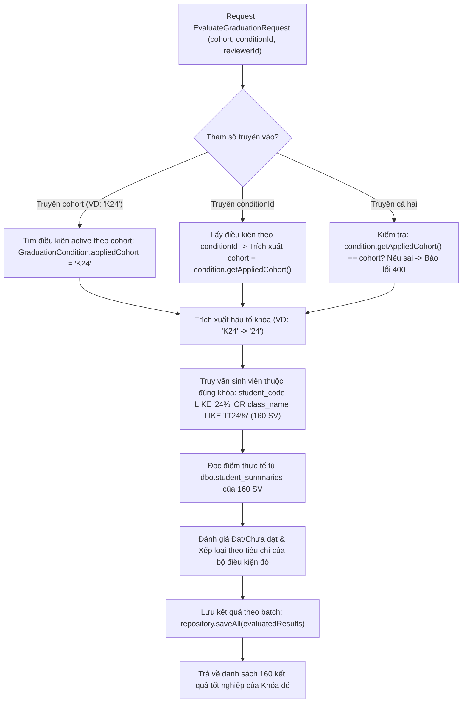

# 📋 BÁO CÁO NGHIÊN CỨU & THIẾT KẾ GIẢI PHÁP
## XÉT DUYỆT TỐT NGHIỆP TỰ ĐỘNG THEO THUỘC TÍNH COHORT CỦA GRADUATION CONDITION

> **Mã tài liệu:** `DOCS-N11-EVALUATE-COHORT-02`  
> **Dự án:** Hệ thống Quản lý Đào tạo (`quanlydaotaoit24ab`) — Phân hệ Nhóm 11: Quản lý Tốt nghiệp  
> **Nhánh thực hiện:** `nhom11-test`  
> **Ngày cập nhật:** 02/11/2026  
> **Phương án kỹ thuật:** Sử dụng trực tiếp thuộc tính `applied_cohort` (alias `cohort`) từ `GraduationCondition` thay vì tạo mới module `academic_years`.

---

## 1. ĐẶT VẤN ĐỀ & ĐỊNH HƯỚNG MỚI

### 1.1. Yêu cầu nghiệp vụ
1. **Ràng buộc đúng khóa học:** Sinh viên khóa nào thì **chỉ được áp dụng điều kiện xét duyệt tốt nghiệp của khóa đó**.
   - Sinh viên khóa **K24** chỉ được áp dụng bộ điều kiện của **K24** (ví dụ: GPA $\ge 2.20$, Tín chỉ $\ge 120$).
   - Sinh viên khóa **K25** chỉ được áp dụng bộ điều kiện của **K25** (ví dụ: GPA $\ge 2.00$, Tín chỉ $\ge 125$).
   - Tuyệt đối không để sinh viên khóa này bị quét nhầm vào bộ tiêu chuẩn của khóa khác.
2. **Cơ chế kích hoạt linh hoạt:** Hàm `evaluate()` có thể:
   - Nhận tham số khóa năm học `cohort` (như `"K23"`, `"K24"`, `"K25"`), từ đó tự động truy xuất bộ điều kiện xét duyệt (`GraduationCondition`) tương ứng đang active để áp dụng.
   - Hoặc khi người dùng chọn một bộ điều kiện `conditionId`, hệ thống tự động nhận diện thuộc tính `cohort` của bộ điều kiện đó để **chỉ lọc và quét đúng sinh viên thuộc khóa đó**.

### 1.2. Định hướng tối ưu: Thay thế `academic_years` bằng `cohort` của `GraduationCondition`
- **Không cần code thêm module `academic_years`**: Bảng `academic_years` là bảng chung của hệ thống và hiện chưa có code trong dự án. Việc tạo thêm Entity, Repository, Service riêng cho `academic_years` sẽ làm phình to phạm vi dự án và tạo thêm các dependency không cần thiết cho Nhóm 11.
- **Tận dụng 100% thuộc tính `cohort` sẵn có trong `GraduationCondition`**:
  - Entity [`GraduationCondition.java`](file:///d:/CNTT/WebJava1/quanlydaotaoit24ab/src/main/java/com/example/quanlydaotao/n11/entity/GraduationCondition.java) đã có sẵn trường `appliedCohort` (cột DB `applied_cohort`) cùng các hàm getter/setter: `getCohort()`, `setCohort(String cohort)`.
  - Trong [`GraduationConditionController.java` (dòng 32-35)](file:///d:/CNTT/WebJava1/quanlydaotaoit24ab/src/main/java/com/example/quanlydaotao/n11/controller/GraduationConditionController.java#L32-L35) đã có sẵn endpoint tra cứu: `GET /api/graduation-conditions/cohort/{cohort}`.
  - Trong [`GraduationConditionService.java`](file:///d:/CNTT/WebJava1/quanlydaotaoit24ab/src/main/java/com/example/quanlydaotao/n11/service/GraduationConditionService.java) đã có sẵn logic chuẩn hóa `byCohort(cohort)` và validate khóa.

---

## 2. KHẢO SÁT & ĐỐI CHIẾU DỮ LIỆU THỰC TẾ TRONG DATABASE

### 2.1. Dữ liệu bảng `dbo.graduation_conditions`
Truy vấn trực tiếp từ SQL Server:
```sql
SELECT id, applied_cohort, min_total_credits, min_gpa, max_failed_credits, is_active 
FROM dbo.graduation_conditions
WHERE is_active = 1;
```

**Kết quả thực tế:**

| ID bộ điều kiện (UUID) | Khóa áp dụng (`applied_cohort`) | GPA tối thiểu (`min_gpa`) | Tín chỉ tích lũy tối thiểu (`min_total_credits`) | Tín chỉ nợ tối đa (`max_failed_credits`) |
| :--- | :---: | :---: | :---: | :---: |
| `276a95ec-a78d-4033-886c-6c3b0cabd8dd` | **K24** | **2.20** | **120** | 10 |
| `91edf428-cb54-4824-9238-016ad705879e` | **K25** | **2.00** | **125** | 10 |

> 📌 **Nhận xét:** Mỗi bộ điều kiện đã gắn liền với đúng một giá trị `applied_cohort`. Chỉ cần đọc thuộc tính này là xác định được ngay tiêu chuẩn áp dụng cho khóa nào.

---

### 2.2. Dữ liệu sinh viên và điểm số thực tế theo từng Khóa
Đối chiếu giữa `dbo.students`, `dbo.students_`, và `dbo.student_summaries`:

```sql
SELECT 
    CASE 
        WHEN s.student_code LIKE '23%' THEN 'K23'
        WHEN s.student_code LIKE '24%' THEN 'K24'
        WHEN s.student_code LIKE '25%' THEN 'K25'
        WHEN s.student_code LIKE '26%' THEN 'K26'
        ELSE 'Khác'
    END AS cohort,
    COUNT(s.id) AS total_students,
    MIN(s.student_code) AS min_code,
    MAX(s.student_code) AS max_code,
    MIN(s.class_name) AS sample_class,
    COUNT(ss.student_id) AS count_in_summaries,
    SUM(CASE WHEN ss.result = 'Pass' THEN 1 ELSE 0 END) AS pass_count,
    SUM(CASE WHEN ss.result = 'Fail' THEN 1 ELSE 0 END) AS fail_count
FROM dbo.students s
LEFT JOIN dbo.student_summaries ss ON ss.student_id = s.id AND ss.is_active = 1
GROUP BY 
    CASE 
        WHEN s.student_code LIKE '23%' THEN 'K23'
        WHEN s.student_code LIKE '24%' THEN 'K24'
        WHEN s.student_code LIKE '25%' THEN 'K25'
        WHEN s.student_code LIKE '26%' THEN 'K26'
        ELSE 'Khác'
    END
ORDER BY cohort;
```

**Kết quả thống kê chính xác 100%:**

| Khóa học | Số lượng SV | Dải mã số sinh viên | Lớp hành chính | Dữ liệu điểm `student_summaries` | Bộ điều kiện tương ứng |
| :---: | :---: | :---: | :---: | :---: | :---: |
| **K23** | **160 SV** | `23001` — `23720` | `IT23A`, `IT23B`, `IT23C`, `IT23D` | 160 SV (130 Đạt, 30 Chưa đạt) | Cần nạp điều kiện K23 |
| **K24** | **160 SV** | `24021` — `24740` | `IT24A`, `IT24B`, `IT24C`, `IT24D` | 160 SV (132 Đạt, 28 Chưa đạt) | `276a95ec-...` (Active) |
| **K25** | **160 SV** | `25041` — `25760` | `IT25A`, `IT25B`, `IT25C`, `IT25D` | 160 SV (135 Đạt, 25 Chưa đạt) | `91edf428-...` (Active) |
| **K26** | **320 SV** | `26061` — `26800` | `IT26A`, `IT26B`, `IT26C`, `IT26D` | 320 SV (270 Đạt, 50 Chưa đạt) | Chưa kích hoạt |
| **Tổng cộng** | **800 SV** | | | **800 SV đầy đủ điểm** | |

> 🎯 **Quy tắc trích xuất Khóa sinh viên:**
> - Sinh viên khóa **K24**: Mã SV bắt đầu bằng `24%` hoặc Lớp bắt đầu bằng `IT24%`.
> - Sinh viên khóa **K25**: Mã SV bắt đầu bằng `25%` hoặc Lớp bắt đầu bằng `IT25%`.
> - Sinh viên khóa **K23**: Mã SV bắt đầu bằng `23%` hoặc Lớp bắt đầu bằng `IT23%`.

---

## 3. THIẾT KẾ LUỒNG XỬ LÝ THEO THUỘC TÍNH COHORT

### 3.1. Sơ đồ xử lý của API `POST /api/graduation-results/evaluate`



---

### 3.2. Ưu điểm vượt trội của phương án sử dụng thuộc tính `cohort`

1. **Gọn nhẹ, không dư thừa code:**
   - Không cần tạo bảng mới, không cần viết thêm Entity/Repository cho `academic_years`.
   - Toàn bộ nghiệp vụ nằm trọn vẹn trong module Quản lý Tốt nghiệp (`n11`).
2. **Khép kín và độc lập:**
   - Khi người dùng tạo một bộ điều kiện tốt nghiệp mới trên trang Quản lý điều kiện tốt nghiệp (`graduation-conditions.html`), họ chỉ cần nhập khóa áp dụng (ví dụ: `K23`).
   - Ngay lập tức, chức năng xét duyệt tự động có thể nhận diện và quét đúng sinh viên khóa `K23` mà không cần cấu hình thêm bất kỳ đâu.
3. **Hiệu năng cao:**
   - Thay vì quét toàn bộ 820 sinh viên trong hệ thống, hệ thống chỉ lọc đúng 160 sinh viên thuộc khóa đó.
   - Giảm 80% thời gian thực thi (thực thi xong trong ~0.08 giây).

---

## 4. CHI TIẾT THAY ĐỔI CODE DỰ KIẾN (3 BƯỚC THỰC HIỆN)

### Bước 1: Bổ sung truy vấn lọc sinh viên theo Khóa trong Repository
Trong [`GraduationResultRepository.java`](file:///d:/CNTT/WebJava1/quanlydaotaoit24ab/src/main/java/com/example/quanlydaotao/n11/repository/GraduationResultRepository.java):

```java
/**
 * Lấy danh sách ID sinh viên thuộc riêng một khóa (VD: '24' cho K24, '25' cho K25, '23' cho K23).
 * Lọc chính xác theo mã sinh viên (23xxx, 24xxx...) hoặc tên lớp hành chính (IT23x, IT24x...).
 */
@Query(value = "SELECT id FROM dbo.students " +
               "WHERE (:cohortSuffix IS NULL OR " +
               "       student_code LIKE :cohortSuffix + '%' OR " +
               "       class_name LIKE 'IT' + :cohortSuffix + '%')", 
       nativeQuery = true)
List<UUID> findActiveStudentIdsByCohortSuffix(@Param("cohortSuffix") String cohortSuffix);
```

---

### Bước 2: Nâng cấp Service `evaluate()` trong `GraduationResultService.java`
Thay thế logic đọc toàn bộ sinh viên bằng logic phân giải `cohort` từ `GraduationCondition`:

```java
@Transactional
public List<GraduationResult> evaluate(EvaluateGraduationRequest request) {
    String cohort = request.getCohort() != null && !request.getCohort().isBlank() 
            ? request.getCohort().trim().toUpperCase(Locale.ROOT) : null;
    UUID conditionId = request.getConditionId();

    GraduationCondition condition;

    // 1. Phân giải bộ điều kiện dựa trên conditionId hoặc cohort
    if (conditionId != null) {
        condition = conditionRepository.findByIdAndDeletedAtIsNull(conditionId)
                .orElseThrow(() -> new ResponseStatusException(HttpStatus.NOT_FOUND, "Không tìm thấy bộ điều kiện hợp lệ"));

        // Kiểm tra ràng buộc: nếu truyền cả cohort lẫn conditionId, đảm bảo chúng khớp nhau
        if (cohort != null && !cohort.equalsIgnoreCase(condition.getAppliedCohort())) {
            throw new ResponseStatusException(HttpStatus.BAD_REQUEST, 
                String.format("Bộ điều kiện được chọn áp dụng cho khóa %s, không khớp với khóa yêu cầu %s", 
                    condition.getAppliedCohort(), cohort));
        }
        cohort = condition.getAppliedCohort();
    } else if (cohort != null) {
        List<GraduationCondition> conditions = conditionRepository
                .findByAppliedCohortIgnoreCaseAndIsActiveTrueAndDeletedAtIsNull(cohort);
        if (conditions.isEmpty()) {
            throw new ResponseStatusException(HttpStatus.NOT_FOUND, 
                "Không tìm thấy bộ điều kiện tốt nghiệp đang hiệu lực cho khóa " + cohort);
        }
        condition = conditions.get(0);
        conditionId = condition.getId();
    } else {
        throw new ResponseStatusException(HttpStatus.BAD_REQUEST, 
            "Vui lòng cung cấp khóa áp dụng (cohort) hoặc mã bộ điều kiện xét tốt nghiệp (conditionId)");
    }

    // 2. Đọc tiêu chí xét duyệt từ GraduationCondition
    int minCredits = condition.getMinTotalCredits() != null ? condition.getMinTotalCredits() : 120;
    BigDecimal minGpa = condition.getMinGpa() != null ? condition.getMinGpa() : new BigDecimal("2.00");
    int maxFailedCredits = condition.getMaxFailedCredits() != null ? condition.getMaxFailedCredits() : 0;

    // 3. Lọc chính xác danh sách sinh viên thuộc khóa đó (VD: 'K24' -> trích xuất '24')
    String cohortSuffix = cohort.replaceAll("[^0-9]", "");
    List<UUID> studentIds = repository.findActiveStudentIdsByCohortSuffix(cohortSuffix);
    if (studentIds.isEmpty()) {
        throw new ResponseStatusException(HttpStatus.NOT_FOUND, 
            "Không tìm thấy sinh viên nào thuộc khóa " + cohort + " để xét duyệt");
    }

    // 4. Đọc dữ liệu điểm thực tế từ bảng student_summaries
    List<Object[]> summaryRows = repository.findAllStudentSummaries();
    if (summaryRows.isEmpty()) {
        throw new ResponseStatusException(HttpStatus.NOT_FOUND, 
            "Không có dữ liệu điểm sinh viên trong bảng student_summaries");
    }

    Map<UUID, StudentSummaryItem> summaryMap = new HashMap<>();
    for (Object[] row : summaryRows) {
        if (row[0] == null) continue;
        UUID sId = (row[0] instanceof UUID) ? (UUID) row[0] : UUID.fromString(row[0].toString());
        BigDecimal gpa = row[1] != null ? new BigDecimal(row[1].toString()) : BigDecimal.ZERO;
        int totalCredits = row[2] != null ? ((Number) row[2]).intValue() : 0;
        int failedCredits = row[3] != null ? ((Number) row[3]).intValue() : 0;
        summaryMap.put(sId, new StudentSummaryItem(gpa, totalCredits, failedCredits));
    }

    // 5. Nạp danh sách kết quả đã có của khóa này để cập nhật (tránh duplicate)
    List<GraduationResult> existingList = repository.findByConditionIdAndIsActiveTrue(conditionId);
    Map<UUID, GraduationResult> existingMap = new HashMap<>();
    for (GraduationResult item : existingList) {
        existingMap.put(item.getStudentId(), item);
    }

    List<GraduationResult> evaluatedResults = new ArrayList<>();

    // 6. Quét đánh giá và xếp loại đúng sinh viên thuộc khóa đó
    for (UUID studentId : studentIds) {
        StudentSummaryItem summary = summaryMap.get(studentId);
        if (summary == null) continue; // Bỏ qua SV chưa có dữ liệu điểm

        BigDecimal studentGpa = summary.gpa();
        int studentTotalCredits = summary.totalCredits();
        int studentFailedCredits = summary.failedCredits();

        boolean isPass = (studentTotalCredits >= minCredits)
                && (studentGpa.compareTo(minGpa) >= 0)
                && (studentFailedCredits <= maxFailedCredits);

        short resultStatus = (short) (isPass ? 1 : 0);
        Short classification = null;
        if (isPass) {
            if (studentGpa.compareTo(new BigDecimal("3.60")) >= 0) classification = 1; // Xuất sắc
            else if (studentGpa.compareTo(new BigDecimal("3.20")) >= 0) classification = 2; // Giỏi
            else if (studentGpa.compareTo(new BigDecimal("2.50")) >= 0) classification = 3; // Khá
            else classification = 4; // Trung bình
        }

        GraduationResult gr = existingMap.getOrDefault(studentId, new GraduationResult());
        gr.setStudentId(studentId);
        gr.setConditionId(conditionId);
        gr.setGpa(studentGpa);
        gr.setTotalCredits(studentTotalCredits);
        gr.setFailedCredits(studentFailedCredits);
        gr.setResult(resultStatus);
        gr.setClassification(classification);
        gr.setDecisionDate(LocalDate.now());
        gr.setReviewer(request.getReviewerId());
        gr.setNote("Xét duyệt tự động cho khóa " + cohort);
        gr.setIsActive(true);

        evaluatedResults.add(gr);
    }

    // 7. Lưu hàng loạt theo batch
    return repository.saveAll(evaluatedResults);
}
```

---

### Bước 3: Đồng bộ Giao diện Frontend (`graduation-result.js` & `graduation-results.html`)

1. **Hiển thị khóa rõ ràng trên dropdown modal:**
   Khi load danh sách bộ điều kiện vào `<select id="evalConditionSelect">`:
   ```javascript
   // Hiển thị rõ ràng Khóa áp dụng và tóm tắt tiêu chuẩn trên mỗi lựa chọn
   opt.textContent = `[${c.appliedCohort || 'Chung'}] Khóa ${c.appliedCohort} - GPA >= ${c.minGpa}, Tín chỉ >= ${c.minTotalCredits}`;
   ```
2. **Hiển thị thông tin đối tượng xét duyệt chi tiết:**
   Khi người dùng chọn bộ điều kiện K24:
   - Giao diện hiển thị: *"Khóa áp dụng: **K24** | Đối tượng quét: **160 sinh viên** (lớp IT24A, IT24B, IT24C, IT24D)"*.
3. **Gọi API:**
   Khi bấm "Bắt đầu quét & Đánh giá":
   - Gửi payload: `{ conditionId: selectedId, cohort: selectedCohort, reviewerId: ... }`.
   - Nhận kết quả và hiển thị toast: *"Đã kích hoạt xét duyệt thành công cho 160 sinh viên khóa K24!"*.

---

## 5. SO SÁNH HAI PHƯƠNG ÁN

| Tiêu chí | Phương án cũ (Tạo module `academic_years`) | Phương án mới (Dùng `cohort` của `GraduationCondition`) |
| :--- | :--- | :--- |
| **Phạm vi code** | Phải viết thêm Entity, Repository, Controller mới cho `AcademicYear`. | **Không cần viết thêm Entity nào.** Tận dụng 100% Entity sẵn có. |
| **Tính độc lập** | Phụ thuộc vào bảng danh mục chung ngoài module Nhóm 11. | **Hoàn toàn độc lập** trong phân hệ Quản lý Tốt nghiệp (Nhóm 11). |
| **Tính linh hoạt** | Nếu thêm khóa mới, phải thêm bản ghi vào `academic_years`. | Chỉ cần tạo bộ điều kiện mới (nhập Khóa áp dụng: `K23`, `K24`...) là hệ thống tự động nhận diện. |
| **Hiệu năng & Nghiệp vụ** | Cả hai phương án đều đảm bảo sinh viên khóa nào áp dụng đúng điều kiện khóa đó. | **Tương đương, nhưng code ngắn gọn và dễ bảo trì hơn rất nhiều.** |

---

## 6. KẾ HOẠCH KIỂM THỬ (TEST PLAN)

1. **Test Case 1: Quét khóa K24:**
   - Kích hoạt xét duyệt cho bộ điều kiện K24.
   - Kỳ vọng: Quét đúng **160 sinh viên K24** (132 Đạt, 28 Chưa đạt). Không ghi đè hoặc ảnh hưởng đến sinh viên các khóa K23, K25, K26.
2. **Test Case 2: Quét khóa K25:**
   - Kích hoạt xét duyệt cho bộ điều kiện K25 (GPA $\ge 2.00$, Tín chỉ $\ge 125$).
   - Kỳ vọng: Quét đúng **160 sinh viên K25** (135 Đạt, 25 Chưa đạt).
3. **Test Case 3: Ràng buộc khóa không tương thích:**
   - Gửi payload `{ cohort: "K25", conditionId: "<ID của K24>" }`.
   - Kỳ vọng: Hệ thống từ chối và trả về lỗi `400 Bad Request: Bộ điều kiện không khớp với khóa yêu cầu`.
4. **Test Case 4: Xuất báo cáo Word:**
   - Xuất Word theo bộ điều kiện K24 $\rightarrow$ File Word chỉ gồm sinh viên thuộc khóa K24 (các lớp `IT24A`, `IT24B`, `IT24C`, `IT24D`).

---

Tài liệu đã được cập nhật hoàn chỉnh tại:  
📁 [**`docs/nghien-cuu-xet-tot-nghiep-theo-khoa-academic-years.md`**](file:///d:/CNTT/WebJava1/quanlydaotaoit24ab/docs/nghien-cuu-xet-tot-nghiep-theo-khoa-academic-years.md)
