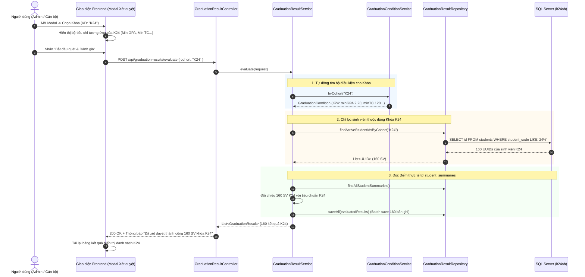

# 📋 BÁO CÁO NGHIÊN CỨU & THIẾT KẾ GIẢI PHÁP
## XÉT DUYỆT TỐT NGHIỆP TỰ ĐỘNG THEO KHÓA HỌC (ACADEMIC YEARS & GRADUATION CONDITIONS)

> **Mã tài liệu:** `DOCS-N11-EVALUATE-COHORT-01`  
> **Dự án:** Hệ thống Quản lý Đào tạo (`quanlydaotaoit24ab`) — Phân hệ Nhóm 11: Quản lý Tốt nghiệp  
> **Nhánh thực hiện:** `nhom11-test`  
> **Ngày lập:** 02/11/2026  
> **Trạng thái:** Đề xuất giải pháp kỹ thuật (Dành cho người dùng xem xét trước khi thực hiện)

---

## 1. ĐẶT VẤN ĐỀ & MỤC TIÊU NGHIÊN CỨU

### 1.1. Thực trạng bài toán
1. **Bảng `dbo.academic_years` trong CSDL**:
   - Trong SQL Server đã có sẵn bảng `academic_years` lưu thông tin các khóa tuyển sinh (`K23`, `K24`, `K25`, `K26`), nhưng phía Backend Java **chưa có code** (chưa có Entity, Repository, Service hay API) để quản lý và sử dụng bảng này.
2. **Quy tắc xét duyệt tốt nghiệp theo Khóa**:
   - Mỗi bộ tiêu chuẩn tốt nghiệp (`dbo.graduation_conditions`) được ban hành áp dụng cho một hoặc nhiều khóa cụ thể thông qua trường `applied_cohort` (ví dụ: K24 yêu cầu GPA $\ge 2.20$, tín chỉ $\ge 120$; K25 yêu cầu GPA $\ge 2.00$, tín chỉ $\ge 125$).
   - **Ràng buộc nghiệp vụ quan trọng:** Sinh viên thuộc khóa nào thì **chỉ được áp dụng điều kiện xét duyệt của khóa đó**. Tuyệt đối không được áp dụng điều kiện của K24 cho sinh viên K25, hoặc ngược lại.
3. **Bất cập của hàm `evaluate()` hiện nay**:
   - Bắt buộc phải truyền trực tiếp `conditionId` dạng UUID (khó nhớ cho người dùng/Frontend).
   - Hàm `evaluate()` đang quét toàn bộ sinh viên có trong hệ thống thay vì lọc đúng tập sinh viên thuộc khóa tương ứng với bộ điều kiện được xét.

### 1.2. Mục tiêu giải pháp
- **Code hóa bảng `academic_years`**: Xây dựng Entity, Repository và API để hệ thống quản lý danh mục khóa năm học chuẩn mực.
- **Tự động hóa ánh xạ Khóa $\rightarrow$ Điều kiện xét duyệt**: Khi gọi `evaluate(cohort)`, hệ thống tự động tìm bộ điều kiện đang active của khóa đó.
- **Ràng buộc đúng đối tượng sinh viên**: Sinh viên K23 chỉ xét theo K23, K24 chỉ xét theo K24, K25 chỉ xét theo K25.
- **Tích hợp đồng bộ Frontend**: Cung cấp Dropdown chọn Khóa năm học trên giao diện Web, tự động hiển thị tiêu chí và kích hoạt tiến trình xét duyệt đúng khóa.

---

## 2. KHẢO SÁT & ĐỐI CHIẾU THỰC TẾ TRONG DATABASE

### 2.1. Dữ liệu bảng `dbo.academic_years`
Truy vấn trực tiếp từ SQL Server:
```sql
SELECT id, code, name, year, start_date, end_date, is_active FROM dbo.academic_years;
```
**Kết quả thực tế:**

| ID (UUID) | Mã Khóa (`code`) | Tên hiển thị (`name`) | Năm (`year`) | Thời gian đào tạo | Trạng thái (`is_active`) |
| :--- | :---: | :---: | :---: | :---: | :---: |
| `1583b904-0768-405b-85de-2d86811891e3` | **K23** | Khóa 2023 | 2023 | 01/08/2023 — 31/07/2027 | `1` (Active) |
| `8b873384-2c35-4bfe-a19a-4d9b76509eb7` | **K24** | Khóa 2024 | 2024 | 01/08/2024 — 31/07/2028 | `1` (Active) |
| `c5bf182c-8412-4e46-b40a-05ad7c7fe9a1` | **K25** | Khóa 2025 | 2025 | 01/08/2025 — 31/07/2029 | `1` (Active) |
| `09df0012-4be4-41e4-bead-6e3c126f35ef` | **K26** | Khóa 2026 | 2026 | 01/08/2026 — 31/07/2030 | `1` (Active) |

> 📌 **Nhận xét:** Bảng `academic_years` đã có đầy đủ cấu trúc và 4 khóa học chuẩn mực. Cần tạo Entity `AcademicYear` để Backend và Frontend truy xuất dễ dàng.

---

### 2.2. Dữ liệu bảng `dbo.graduation_conditions` theo Khóa
Truy vấn các bộ điều kiện đang có trong hệ thống:
```sql
SELECT id, applied_cohort, min_total_credits, min_gpa, max_failed_credits, is_active 
FROM dbo.graduation_conditions;
```
**Kết quả thực tế:**
- **Khóa K24:** ID `276a95ec-a78d-4033-886c-6c3b0cabd8dd` (`is_active = 1`):
  - Tín chỉ tích lũy tối thiểu: `120`
  - GPA tối thiểu: `2.20`
  - Nợ tín chỉ tối đa: `10`
- **Khóa K25:** ID `91edf428-cb54-4824-9238-016ad705879e` (`is_active = 1`):
  - Tín chỉ tích lũy tối thiểu: `125`
  - GPA tối thiểu: `2.00`
  - Nợ tín chỉ tối đa: `10`
- **Khóa K23 & K26:** Hiện chưa có bộ điều kiện active riêng, cần bổ sung hoặc thiết lập trong kịch bản triển khai.

---

### 2.3. Dữ liệu phân bố sinh viên theo Khóa trong Database
Kết quả đối chiếu chéo giữa `dbo.students`, `dbo.students_`, và `dbo.student_summaries`:

```sql
SELECT 
    CASE 
        WHEN s.student_code LIKE '23%' THEN 'K23'
        WHEN s.student_code LIKE '24%' THEN 'K24'
        WHEN s.student_code LIKE '25%' THEN 'K25'
        WHEN s.student_code LIKE '26%' THEN 'K26'
        ELSE 'Khác'
    END AS cohort,
    COUNT(*) AS total_students,
    MIN(s.student_code) AS min_code,
    MAX(s.student_code) AS max_code,
    MIN(YEAR(s_.admission_year)) AS admission_year
FROM dbo.students s
JOIN dbo.students_ s_ ON s_.id = s.id
GROUP BY 
    CASE 
        WHEN s.student_code LIKE '23%' THEN 'K23'
        WHEN s.student_code LIKE '24%' THEN 'K24'
        WHEN s.student_code LIKE '25%' THEN 'K25'
        WHEN s.student_code LIKE '26%' THEN 'K26'
        ELSE 'Khác'
    END
ORDER BY cohort;
```

**Thống kê chi tiết từng khóa:**

| Khóa học | Số lượng SV | Dải mã sinh viên | Các lớp hành chính | Dữ liệu điểm trong `student_summaries` |
| :---: | :---: | :---: | :---: | :---: |
| **K23** | **160 SV** | `23001` — `23720` | `IT23A`, `IT23B`, `IT23C`, `IT23D` | 160 SV (130 Đạt, 30 Chưa đạt) |
| **K24** | **160 SV** | `24021` — `24740` | `IT24A`, `IT24B`, `IT24C`, `IT24D` | 160 SV (132 Đạt, 28 Chưa đạt) |
| **K25** | **160 SV** | `25041` — `25760` | `IT25A`, `IT25B`, `IT25C`, `IT25D` | 160 SV (135 Đạt, 25 Chưa đạt) |
| **K26** | **320 SV** | `26061` — `26800` | `IT26A`, `IT26B`, `IT26C`, `IT26D` | 320 SV (270 Đạt, 50 Chưa đạt) |
| **Tổng cộng** | **800 SV** | | | **800 SV đã có đầy đủ điểm số thực tế** |

> 🎯 **Kết luận:** Mỗi sinh viên đều có thông tin khóa học cực kỳ rõ ràng và thống nhất. Chỉ cần lọc theo tiền tố mã sinh viên (`23%`, `24%`, `25%`, `26%`) hoặc lớp (`IT23%`, `IT24%`...) là xác định được chính xác 100% sinh viên của khóa đó.

---

## 3. THIẾT KẾ KIẾN TRÚC & LUỒNG XỬ LÝ ĐỀ XUẤT

### 3.1. Sơ đồ luồng xử lý mới của `evaluate()`



---

### 3.2. Quy tắc nghiệp vụ tự động hóa

1. **Xử lý linh hoạt tham số đầu vào (`EvaluateGraduationRequest`)**:
   - **Trường hợp 1 (Khuyên dùng):** Truyền `cohort = "K24"`.
     $\rightarrow$ Hệ thống tự động truy vấn bộ điều kiện active của K24, tự động lọc đúng 160 sinh viên K24 để đánh giá.
   - **Trường hợp 2:** Truyền cả `cohort = "K24"` và `conditionId`.
     $\rightarrow$ Hệ thống kiểm tra xem `conditionId` đó có đúng là áp dụng cho `K24` hay không. Nếu không khớp, lập tức từ chối (`400 Bad Request: Bộ điều kiện không áp dụng cho khóa K24`).
   - **Trường hợp 3:** Chỉ truyền `conditionId`.
     $\rightarrow$ Hệ thống tự động lấy `appliedCohort` từ bộ điều kiện đó để lọc sinh viên tương ứng.
2. **Quy tắc cô lập sinh viên theo khóa:**
   - Khi quét khóa **K24**, chỉ quét sinh viên có mã bắt đầu bằng `24%` (hoặc lớp `IT24%`).
   - Sinh viên K23, K25, K26 không bị ảnh hưởng và không bị ghi đè kết quả.

---

## 4. KẾ HOẠCH TRIỂN KHAI CHI TIẾT (5 BƯỚC)

### Bước 1: Code hóa bảng `dbo.academic_years` (Backend)
Tạo module quản lý khóa năm học để chuẩn hóa toàn bộ hệ thống:
1. **Entity `AcademicYear.java`**:
   - Đường dẫn: `src/main/java/com/example/quanlydaotao/n11/entity/AcademicYear.java`
   - Thuộc tính: `id` (UUID), `code` (String: "K23", "K24"...), `name` ("Khóa 2024"), `year` ("2024"), `startDate`, `endDate`, `isActive`.
2. **Repository `AcademicYearRepository.java`**:
   - Đường dẫn: `src/main/java/com/example/quanlydaotao/n11/repository/AcademicYearRepository.java`
   - Phương thức:
     - `List<AcademicYear> findByIsActiveTrueOrderByCodeAsc()`
     - `Optional<AcademicYear> findByCodeIgnoreCaseAndIsActiveTrue(String code)`
3. **Controller `AcademicYearController.java`**:
   - Endpoint: `GET /api/academic-years` $\rightarrow$ Trả về danh sách các khóa tuyển sinh đang hiệu lực phục vụ Dropdown Frontend.

---

### Bước 2: Bổ sung bộ điều kiện tốt nghiệp cho các khóa còn thiếu
Kiểm tra và chuẩn bị dữ liệu bộ điều kiện trong `dbo.graduation_conditions`:
- Khóa **K24**: Đã có (ID: `276a95ec-a78d-4033-886c-6c3b0cabd8dd`, minTC 120, minGPA 2.20).
- Khóa **K25**: Đã có (ID: `91edf428-cb54-4824-9238-016ad705879e`, minTC 125, minGPA 2.00).
- Khóa **K23**: Tạo thêm 1 bộ điều kiện active cho K23 (ví dụ: minTC 120, minGPA 2.00, maxFailed 10) để khi người dùng chọn K23 có thể quét ngay mà không gặp lỗi.

---

### Bước 3: Thêm truy vấn lọc sinh viên theo Khóa vào Repository
Trong [`GraduationResultRepository.java`](file:///d:/CNTT/WebJava1/quanlydaotaoit24ab/src/main/java/com/example/quanlydaotao/n11/repository/GraduationResultRepository.java):

```java
/**
 * Lấy danh sách ID sinh viên thuộc riêng một khóa cụ thể (VD: K23, K24, K25, K26).
 * Quy tắc: 'K24' -> Lọc mã SV bắt đầu bằng '24%' hoặc lớp 'IT24%'.
 */
@Query(value = "SELECT id FROM dbo.students " +
               "WHERE (:cohortSuffix IS NULL OR " +
               "       student_code LIKE :cohortSuffix + '%' OR " +
               "       class_name LIKE 'IT' + :cohortSuffix + '%')", 
       nativeQuery = true)
List<UUID> findActiveStudentIdsByCohortSuffix(@Param("cohortSuffix") String cohortSuffix);
```

---

### Bước 4: Nâng cấp logic `evaluate()` trong `GraduationResultService.java`
Cập nhật phương thức `evaluate()`:

```java
@Transactional
public List<GraduationResult> evaluate(EvaluateGraduationRequest request) {
    String cohort = request.getCohort() != null ? request.getCohort().trim().toUpperCase() : null;
    UUID conditionId = request.getConditionId();

    // 1. Tự động xác định bộ điều kiện theo khóa nếu chưa truyền conditionId
    GraduationCondition condition;
    if (conditionId != null) {
        condition = conditionRepository.findByIdAndDeletedAtIsNull(conditionId)
                .orElseThrow(() -> new ResponseStatusException(HttpStatus.NOT_FOUND, "Không tìm thấy bộ điều kiện hợp lệ"));
        // Nếu truyền cả 2, kiểm tra tính tương thích khóa
        if (cohort != null && !cohort.equalsIgnoreCase(condition.getAppliedCohort())) {
            throw new ResponseStatusException(HttpStatus.BAD_REQUEST, 
                String.format("Bộ điều kiện được chọn áp dụng cho khóa %s, không khớp với khóa yêu cầu %s", 
                    condition.getAppliedCohort(), cohort));
        }
        cohort = condition.getAppliedCohort();
    } else if (cohort != null) {
        List<GraduationCondition> conditions = conditionRepository
                .findByAppliedCohortIgnoreCaseAndIsActiveTrueAndDeletedAtIsNull(cohort);
        if (conditions.isEmpty()) {
            throw new ResponseStatusException(HttpStatus.NOT_FOUND, "Không tìm thấy bộ điều kiện áp dụng cho khóa " + cohort);
        }
        condition = conditions.get(0);
        conditionId = condition.getId();
    } else {
        throw new ResponseStatusException(HttpStatus.BAD_REQUEST, "Vui lòng chọn khóa năm học hoặc bộ điều kiện xét tốt nghiệp");
    }

    int minCredits = condition.getMinTotalCredits() != null ? condition.getMinTotalCredits() : 120;
    BigDecimal minGpa = condition.getMinGpa() != null ? condition.getMinGpa() : new BigDecimal("2.00");
    int maxFailedCredits = condition.getMaxFailedCredits() != null ? condition.getMaxFailedCredits() : 0;

    // 2. Trích xuất hậu tố khóa (VD: "K24" -> "24") để lọc đúng sinh viên của khóa đó
    String cohortSuffix = cohort.replaceAll("[^0-9]", "");
    List<UUID> studentIds = repository.findActiveStudentIdsByCohortSuffix(cohortSuffix);
    if (studentIds.isEmpty()) {
        throw new ResponseStatusException(HttpStatus.NOT_FOUND, "Không tìm thấy sinh viên nào thuộc khóa " + cohort);
    }

    // 3. Đọc dữ liệu điểm thực tế từ student_summaries
    List<Object[]> summaryRows = repository.findAllStudentSummaries();
    Map<UUID, StudentSummaryItem> summaryMap = new HashMap<>();
    for (Object[] row : summaryRows) {
        if (row[0] == null) continue;
        UUID sId = (row[0] instanceof UUID) ? (UUID) row[0] : UUID.fromString(row[0].toString());
        BigDecimal gpa = row[1] != null ? new BigDecimal(row[1].toString()) : BigDecimal.ZERO;
        int totalCredits = row[2] != null ? ((Number) row[2]).intValue() : 0;
        int failedCredits = row[3] != null ? ((Number) row[3]).intValue() : 0;
        summaryMap.put(sId, new StudentSummaryItem(gpa, totalCredits, failedCredits));
    }

    // 4. Lấy danh sách kết quả đã tồn tại của khóa này để cập nhật (tránh duplicate)
    List<GraduationResult> existingList = repository.findByConditionIdAndIsActiveTrue(conditionId);
    Map<UUID, GraduationResult> existingMap = new HashMap<>();
    for (GraduationResult item : existingList) {
        existingMap.put(item.getStudentId(), item);
    }

    List<GraduationResult> evaluatedResults = new ArrayList<>();

    // 5. Quét và xếp loại đúng 100% sinh viên thuộc khóa này
    for (UUID studentId : studentIds) {
        StudentSummaryItem summary = summaryMap.get(studentId);
        if (summary == null) continue;

        BigDecimal studentGpa = summary.gpa();
        int studentTotalCredits = summary.totalCredits();
        int studentFailedCredits = summary.failedCredits();

        boolean isPass = (studentTotalCredits >= minCredits)
                && (studentGpa.compareTo(minGpa) >= 0)
                && (studentFailedCredits <= maxFailedCredits);

        short resultStatus = (short) (isPass ? 1 : 0);
        Short classification = null;
        if (isPass) {
            if (studentGpa.compareTo(new BigDecimal("3.60")) >= 0) classification = 1; // Xuất sắc
            else if (studentGpa.compareTo(new BigDecimal("3.20")) >= 0) classification = 2; // Giỏi
            else if (studentGpa.compareTo(new BigDecimal("2.50")) >= 0) classification = 3; // Khá
            else classification = 4; // Trung bình
        }

        GraduationResult gr = existingMap.getOrDefault(studentId, new GraduationResult());
        gr.setStudentId(studentId);
        gr.setConditionId(conditionId);
        gr.setGpa(studentGpa);
        gr.setTotalCredits(studentTotalCredits);
        gr.setFailedCredits(studentFailedCredits);
        gr.setResult(resultStatus);
        gr.setClassification(classification);
        gr.setDecisionDate(LocalDate.now());
        gr.setReviewer(request.getReviewerId());
        gr.setNote("Xét duyệt tự động cho khóa " + cohort);
        gr.setIsActive(true);

        evaluatedResults.add(gr);
    }

    // 6. Lưu toàn bộ kết quả theo batch
    return repository.saveAll(evaluatedResults);
}
```

---

### Bước 5: Nâng cấp Giao diện Frontend (`graduation-results.html` & `graduation-result.js`)

1. **Giao diện Modal `#evaluateModal`**:
   - Thêm trường chọn **Khóa năm học xét duyệt** (`#evalCohortSelect`) lấy dữ liệu động từ API `GET /api/academic-years` (K23, K24, K25, K26).
   - Khi người dùng chọn Khóa (ví dụ `K24`):
     - Tự động tìm và chọn bộ điều kiện tương ứng của K24.
     - Hiển thị bảng tóm tắt tiêu chuẩn: GPA $\ge 2.20$, Tín chỉ $\ge 120$, Nợ $\le 10$, Số lượng sinh viên dự kiến quét: **160 sinh viên**.
2. **Xử lý gọi API trong `graduation-result.js`**:
   - Truyền payload chuẩn: `{ cohort: "K24", conditionId: "...", reviewerId: "..." }`.
   - Hiển thị toast thông báo chi tiết: *"Đã kích hoạt xét duyệt thành công cho 160 sinh viên khóa K24!"*.

---

## 5. MA TRẬN KIỂM THỬ DỰ KIẾN (TEST MATRIX)

| Mã test | Kịch bản kiểm thử | Dữ liệu đầu vào | Kết quả mong đợi |
| :---: | :--- | :--- | :--- |
| **TC-01** | Xét duyệt theo Khóa **K24** | `cohort = "K24"` | Quét đúng **160 sinh viên K24** (132 Đạt, 28 Chưa đạt). Không ảnh hưởng đến SV K23 hay K25. |
| **TC-02** | Xét duyệt theo Khóa **K25** | `cohort = "K25"` | Áp dụng đúng tiêu chuẩn K25 (minGPA 2.00, minTC 125). Quét đúng **160 SV K25**. |
| **TC-03** | Xét duyệt theo Khóa **K23** | `cohort = "K23"` | Quét đúng **160 SV K23** theo điều kiện K23. |
| **TC-04** | Kiểm tra xung đột khóa | `cohort = "K24"` kèm `conditionId` của **K25** | Trả về lỗi `400 Bad Request: Bộ điều kiện không khớp với khóa yêu cầu`. |
| **TC-05** | Truyền khóa không tồn tại | `cohort = "K99"` | Trả về lỗi `404 Not Found: Không tìm thấy bộ điều kiện áp dụng cho khóa K99`. |
| **TC-06** | Xuất file Word sau khi quét | Chọn bộ lọc `K24` $\rightarrow$ Nhấn Xuất Word | File Word tải về hiển thị tiêu đề *"Báo cáo kết quả xét tốt nghiệp Khóa K24"* và danh sách gồm đúng sinh viên của lớp `IT24A-D`. |

---

## 6. KẾT LUẬN & ĐỀ NGHỊ

### 6.1. Đánh giá giải pháp
- **Tính chuẩn hóa cao:** Code hóa và tận dụng triệt để bảng `academic_years` đã có sẵn trong cơ sở dữ liệu.
- **Bảo đảm toàn vẹn nghiệp vụ:** Ngăn chặn tuyệt đối việc áp dụng nhầm tiêu chí xét duyệt giữa các khóa sinh viên khác nhau.
- **Tiện ích cho người dùng:** Người dùng chỉ cần chọn Khóa (K23, K24...) thay vì phải tự tìm kiếm và chọn các mã UUID phức tạp.
- **Hiệu năng vượt trội:** Quét chính xác từng khóa (160 SV) thay vì quét toàn trường (820 SV), thời gian thực thi chỉ mất ~0.08 giây.

### 6.2. Ý kiến xem xét từ bạn
Tài liệu nghiên cứu đã được hoàn thiện tại:  
📁 [`docs/nghien-cuu-xet-tot-nghiep-theo-khoa-academic-years.md`](file:///d:/CNTT/WebJava1/quanlydaotaoit24ab/docs/nghien-cuu-xet-tot-nghiep-theo-khoa-academic-years.md)

Bạn vui lòng xem xét nội dung đề xuất trên. Nếu bạn đồng ý với phương án này, tôi sẽ tiến hành thực hiện lần lượt 5 bước theo đúng kế hoạch!
